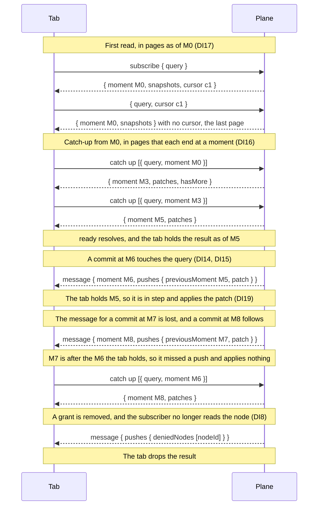

# Upgrading queries: each names the node it reads under, and its subscriber holds the whole result, kept current by patches

**Status:** Pass 1, with `/review-task` Stage 1 run on 2026-11-24; phases are not written. `/task-management` routed it docs-first: `QueryDescriptor` is what every generated app writes its queries against. The docs the model reads are drafted in § *Doc drafts*, as diffs this file holds until its docs phase applies them, so the docs in the tree and the embed teach only what is built. It is the next to build, before the wipe (D22), and [nebula-app-lifecycle-hooks.md](nebula-app-lifecycle-hooks.md) delivers DI22 after it. Larry may split it later.

## Conventions

Items carry IDs, numbered in the order they were raised and never reused: `B` is something in today's code that stands in the way, `DI` an item of design intent, `C` a claim the design rests on that someone can check, `D` a decision Larry made, and `Q` an open question. C4 is the fourth claim raised, wherever it sits. A gap is an item removed or answered.

## Objective

**A query names the orgTree node it reads under, and is checked against `read` there. Its subscriber then holds the whole result, each resource's value included, and is kept current by merge patches computed once per change. A client coming back names the moment it holds and receives only what it missed.**

The node is one new required field on the object every query is written as:

```ts
interface QueryDescriptor {
  typeName: string;      // unchanged: one type per query
  nodeId: string;        // NEW and required: the node to read under, and every node beneath it
  filter: Filter;        // unchanged
  allowScan?: boolean;   // unchanged
}
```

- **Every query written today breaks once.** Our own readers, the docs the model reads and each generated app's queries gain the node in the same change, and nothing accepts the old shape (DI12).
- **A page that wants several types subscribes to each and merges them itself.** Each query delivers whole values, so the page has what it needs to merge. One query across types is in § *Beyond this task*.
- **The moment a client names is one it already holds.** A moment is the `validFrom` one transaction gives everything it writes, such as `2026-11-20T15:04:05.124Z`. So a catch-up reads the past only for the resources written since, each by its key, and no query runs as of a past moment (DI23).

A page reads a list this way:

```ts
const thread = client.resources.subscribeQuery({
  typeName: 'Message',
  nodeId: MESSAGES_NODE_ID,         // NEW: reads at this node and beneath it
  filter: { chat: DEFAULT_CHAT_ID },
});
await thread.ready;                 // the whole result is held; the client asked for it a page at a time (DI17)
const posts = thread.resourceIds
  .map((id) => store.resources.Message[id])               // held already: this read subscribes to nothing
  .sort((a, b) => a.meta.validFrom.localeCompare(b.meta.validFrom));   // NEW: the page sorts its copy (D2)
for (const { value, meta } of posts) showPost(value.content, meta.validFrom);
// GONE: thread.setRenderWindow(), thread.more, and a subscription for each row
```

`store.resources.Message[id]` is the entry every other read of a resource uses, and DI19 says what sits behind it. Code inside the Galaxy reads the same query without a subscription (DI24).

| Reader | Today | After |
|---|---|---|
| The Galaxy's round store | every `Round` naming the message, then keeps those at `rounds` | the `Round`s under `rounds` |
| Studio's tool-call marks | every `Round` naming the message, then keeps those the agent last wrote | the `Round`s under `rounds` |
| The Galaxy's waiting posts | the oldest 1,000 `Message`s, each read again to check `read` | every `Message` under `messages` (D10) |
| Studio's thread | the oldest 1,000 `Message` ids, and a subscription per rendered row | every `Message` under `messages`, values included |
| Studio's landed build | the last of the oldest 1,000 `ServedBuild`s | the `ServedBuild` with the latest write |

## Context

**A query names a type and a filter, and answers the matches anywhere on the host.** Studio's marks ask `{ typeName: 'Round', filter: { message: id } }`, built by `roundsOf` in `participants.ts`. The plane runs that filter over every current `Round` the Galaxy holds, then climbs the tree once for each distinct node a result sits under, to find the ones the reader may see.

**Because a query cannot say where it reads, our own readers filter afterwards.** A member who can post at `messages` can also write a `Round` there naming a running turn, so the round store in `galaxy.ts` keeps only the rounds at `ROUNDS_NODE_ID`. Studio's `toolCallMarks` keeps only rounds whose current snapshot `agent:lumenize` wrote. The Galaxy's `#thread()` reads every `Message` with no check, then reads each one again and skips any its read is refused. Each is a second check beside the tree, which ADR-025 rules out, and the marks' test is the one `calibration.md` § 16 names: reading who wrote a resource to decide whether to trust it. `access-control.md` § *Drawing the tree: a node for each audience* teaches user-developers the same thing, and our own readers do not follow it yet.

**A query also stops at 1,000.** It orders by each result's latest write, oldest first, and keeps the first `QUERY_RESULT_CAP` with `more` set. So a list that grows keeps its oldest entries and drops its newest. In a Galaxy whose chat passes 1,000 messages, the agent stops seeing new posts (C4). Nothing goes red when that happens, and nothing has reached the cap yet.

**A live query re-sends its whole list on every write that touches it, and again after every reconnect.** A push carries the result's ids in order, up to 1,000 of them, about 40 KB. Each row's content comes separately, through a subscription the tab opens for each row it renders, and each costs the host a billed write when it opens and another when it closes (C17). So when one deal of a thousand changes stage, the tabs showing that deal get its one snapshot, and every subscriber also gets all thousand ids. That happens even when the list did not change, because `#touches` answers only whether a write touched the query. After a reconnect the client subscribes again, and the whole list comes back however little changed while it was away.

**The Resource Events prototype already settled how a client keeps a collection current.** Its `sync` method, in `tasks/archive/sync-method.md` of the `resource-webhooks-on-events` repo beside this one, answers a first read in pages and a catch-up from a moment in pages that end at a moment. Each event names the moment before it, so a client can tell it missed one. This task gives Lumenize's queries the same model, so the MCP interface planned for them is a view of what the socket already carries. One difference runs the other way: a push here carries the patch, and the proposal is being revised so an event can too (D4).

What stands in the way today:

- **B1. `QueryDescriptor` names no node.** It is `{ typeName, filter, allowScan? }` in `query-hash.ts`, so `#evaluateQuery` in `resources.ts` reads the whole type, and `#readableNodes` resolves `read` for each distinct node of the results, per subscriber, per push.
- **B2. A query answers at most 1,000 results, in one fixed order.** `#evaluateQuery`'s one statement ends `ORDER BY validFrom, resourceId LIMIT 1001`, and `more` is all the client hears of the rest.
- **B3. `Snapshots` has no index that leads with `nodeId`.** Its one fixed index, `idx_Snapshots_current`, is on `(resourceId, validTo)`, and every query index an `@index` declares leads with a field of the value.
- **B4. A change to the tree reruns no live query.** `#rerunQueriesForCommit` runs on a commit of resources, and its JSDoc says a permission change reruns nothing; the client re-asks for whatever it was denied at the next tree change.
- **B5. A push carries the whole list.** `#broadcastQueries` evaluates the query and sends `QueryUpdatePayload`'s `resourceIds`, and `handleQueryUpdate` in `client-resources.ts` replaces the client's list with each one.
- **B6. A re-subscribe names nothing the client holds.** `subscribeQuery(ontologyVersion, query)` takes no moment, and `#restoreSubscriptions` sends every query again after a reconnect, each answered in full (C14).
- **B7. A row's content comes through a subscription of its own.** `setRenderWindow` opens one for each rendered row and releases it 2 s after the row scrolls away (`#reconcileQueryWindow`), and each open and release is a billed write on the host (C17).

The sections that follow state what the descriptor and its pushes become, the claims that design rests on, Larry's decisions, and the questions still open.

## Goals

1. **A query answers only what sits under the node it names, so the code that asked keeps everything it gets back.** Today a query answers matches from anywhere on the host, and the round store, Studio's marks and the Galaxy's thread each throw part of the answer away.
2. **A query is checked once, at its node.** A grant at a node reaches everything beneath it, so `read` there covers every result, and a reader without it reads none of them (D6). Today the plane looks up every result's node, for each subscriber on each push (B1).
3. **A list of any size reaches its reader whole, and the host never holds more than a page of it.** Today it shows the oldest 1,000 (B2), which quietly stalls the agent in a long chat (C4). Code inside the Galaxy, such as the agent loop, reads a page at a time too, and holds no subscription (DI24).
4. **A change to one result sends that one result.** A deal that changes stage reaches each subscriber as a patch of that deal. Today every subscriber gets the whole list (B5).
5. **A client that missed a few writes receives only those.** A tab that slept through a few new messages receives those messages. Today a reconnect sends the whole list again (B6).
6. **A row on screen draws from what the client holds.** Scrolling a list opens no subscription and writes nothing on the host. Today each row scrolled into view costs a write and a round trip before it can draw (B7).
7. **Nothing decided here makes a query as of a past moment harder to add** (Larry, 2026-11-23). A chart of six months runs its query once per month, each reading that month's end through today's tree and today's grants. None of it is built here: this task reads a past version only by its key (DI23), and § *Beyond this task* says what the rest needs. The choices that bear on it most are the indexes of D13 and D14.

## Relationships

- **Took over [nebula-pre-alpha-fast-follow.md](nebula-pre-alpha-fast-follow.md)'s Item 21 and the [backlog.md](backlog.md) row *A query cannot sort, page or limit*** on 2026-11-20, and both left those files, so the descriptor breaks once. Holding the whole result answers what the row asked sort and paging for (D2).
- **After [archive/nebula-turn-stored-round-by-round.md](archive/nebula-turn-stored-round-by-round.md)**, built and archived on 2026-11-19. Its round store and `toolCallMarks` are readers this changes, and its hand-off left their filters open and pointed at Item 21.
- **Before the wipe in [nebula-pre-alpha.md](nebula-pre-alpha.md)**, as a `data` row, or production is wiped again after it (D22). After the first invite, every invited user's app holds queries in today's shape, so the break costs them a rebuild (C9), and C4's stall can reach their Galaxy.
- **Before [nebula-pre-alpha.md](nebula-pre-alpha.md) § *Denied access in generated apps*.** That item renders a query's `deniedNodes`, which under D6 is the query's own node, for a reader who cannot read it. A page queries at a node it knows (D24). That item's sentence that a client re-subscribes when a grant arrives changes for queries, which the plane now tells (D20).
- **Beside [nebula-pre-alpha-fast-follow.md](nebula-pre-alpha-fast-follow.md) § *Item 14: A change travels as a merge patch, not a full value*.** This task patches a query's result. Item 14 patches a resource read on its own and the org tree, each one value on a channel of its own. Both catch up from a moment the client holds.
- **After [nebula-galaxy-builds-its-tree.md](archive/nebula-galaxy-builds-its-tree.md) and before [nebula-app-lifecycle-hooks.md](nebula-app-lifecycle-hooks.md)** (Larry, 2026-11-22). The first, built 2026-11-23, has our Galaxy create its nodes in `onStart` in place of the tree seed, makes `createNode` idempotent, and renamed the `turns` node `rounds` and its constant `ROUNDS_NODE_ID`, the names this file uses. The second moves the ontology into the folder `src/ontology/`, runs the app's `onNewOntologyVersion` when a Star installs a version (D12), and so delivers DI22.
- **Beside the Resource Events proposal**, `proposals/XXXX-resource-events.md` in the `experimental-ext-triggers-events` repo, and its prototype. This task takes their sync model. The proposal is being revised so an event can carry the patch (D4), and this task's push follows what that revision settles. That revision's task file, `tasks/events-carry-the-change.md` in the `resource-webhooks-on-events` repo, also drafts D15's grouping in the proposal's terms: a server groups a subscriber's subscriptions within a timeline, and one sync catches up several uri-specifications. Lumenize does not take the proposal's own answer, one subscription that covers both collections, since that needs one query across types and filters (§ *Beyond this task*).
- **Closes rows of [backlog.md](backlog.md),** deleted at close-out. *A client high-water mark of every `validFrom` it has seen* is DI15's held moment and DI16's catch-up. *The viewport → `setRenderWindow` driver* has nothing left to drive once a row draws from the result (DI19).
- **Before the temporal org tree**, which keeps each node, edge and grant as a resource in `Snapshots`. It has no task file yet, and Larry has set it before the wipe (2026-11-24). [on-hold/wire-merge-patch-sync.md](on-hold/wire-merge-patch-sync.md) § *Does the tree want history?* and § *Option B with the tree's rows as resources* hold its research. It closes the gap D19 leaves.

## Current state

Built already:

- **`QueryDescriptor` and `canonicalQueryHash`**, in `query-hash.ts`, isomorphic, so the client computes a query's hash before it sends anything. *Adapted:* the descriptor gains the node, and the hash covers it (DI9).
- **The query engine** in `packages/resources/src/query/`: `compileWhere` turns a filter into SQL with bound values, `compileQuery` refuses a filter no index can look up, and `compileIndex` builds an `@index`. *Carried over unchanged.*
- **`#evaluateQuery`**, the one place a query reads `Snapshots`. *Adapted:* it reads under the node (D13), a page at a time, as of the moment the read began, with no cap (DI17, DI18).
- **`Snapshots`' indexes**, created in `snapshots.ts`. *Adapted:* the node index replaces `idx_Snapshots_current`, and the index on `(typeName, validFrom)` is new (D13, D14).
- **`#readableNodes` over `OrgTree.evaluatePermissions`**, called by `doQuery` and `#broadcastQueries`. *Adapted:* a query looks only at its own node (DI2, DI3), so neither caller resolves a result's node any more. `evaluatePermissions` stays for single-resource pushes.
- **`#rerunQueriesForCommit` and `#touches`.** *Adapted:* both take the query's node into account, a grant change at or above a query's node is answered too (DI8), and `#touches` returns what changed rather than whether anything did (DI14).
- **`#broadcastQueries`, `QueryUpdatePayload`, and the client's `handleQueryUpdate`.** *Adapted:* a push carries a patch and the moment before it, and the client applies it or catches up (DI14, DI15).
- **`#reconcileQueryWindow` and `setRenderWindow`.** *Deleted:* a row draws from the result the client holds (DI19).
- **`Snapshots`' moment mint and `LATEST_MOMENT_KEY`** in `snapshots.ts`, which give each transaction a moment past the host's latest. *Carried over:* a moment is a cursor across the host (C18).
- **The `Subscriptions` table** in `subscriptions.ts`. *Adapted:* a query's row records the host's latest moment when it was written, in a new column beside `subscribedAt`, which is wall-clock and stays, the plane keeps each live query's last push moment (DI15), and a query's row records whether its subscriber was last told it cannot read (DI8).
- **`#restoreSubscriptions`** in `client-resources.ts`. *Adapted:* a query's re-subscribe names the moment the client holds (DI16).
- **`QUERY_RESULT_CAP` and `more`.** *Deleted:* no subscription has a ceiling (DI18).
- **Resource subscriptions** through `subscribe`, and the store's count of the scopes reading each entry (`incrementRefcount` and `decrementRefcount` in `create-nebula-client.ts`), which subscribes on the first and releases after `unsubscribeGraceMs`. *Adapted:* the count asks whether a live query holds the entry before it subscribes (DI19), and a subscription's push rides the tab's one message (DI15).
- **`findCurrent(typeName, filter)`**, host code with no check of its own, read by the node invite's `_InviteStatus` lookup and the Galaxy's `#thread()`. *Adapted:* it takes a whole descriptor, node included (DI4).
- **`MAX_LIVE_QUERIES_PER_TYPE`**, the most distinct live queries one type may have on a host, 200, and the error past it. *Adapted:* it counts per node, and a write is tested only against queries at or above its node (DI9).
- **The client's `subscribeQuery` and `query`**, in `client-resources.ts`, and `#askAgain`, which re-subscribes whatever was denied at each tree change. *Adapted:* `#askAgain` stops re-asking for queries (DI8).
- **The roster's store path**, `store.lmz.querySubscribers.<typeName>.<field>[value]`, which `trackQuerySubscribersRead` in `create-nebula-client.ts` turns into `{ typeName, filter }`. *Removed,* with the listener that fills it and the subscribe a read of it starts: a roster is read from its handle (DI13).
- **Our own readers:** the round store's `read` in `galaxy.ts`, `toolCallMarks` and `roundsOf` in `participants.ts`, `#thread()` in `galaxy.ts`, and Studio's `openChatThread`, `openServedBuilds` and marks in `App.vue`. *Adapted* (DI4, DI20).
- **The docs the model reads**, `website/docs/nebula/` embedded as `.platform/docs/`, and the `define-the-cast` skill's query. *Adapted:* drafted docs-first (DI11).
- **The `/live` scenarios and tests that query**, which `grep -rln 'subscribeQuery\|resources.query(' apps/nebula/harness/scenarios apps/nebula/test` lists, `query-by-filter` among them. *Adapted* mechanically.

## Design intent

### What a query is

- **DI1. Every query names a node, and answers what sits at that node or beneath it.** `nodeId` is required on `QueryDescriptor`, beside `typeName` and `filter`, and is spelled as a create op spells it. "Beneath" follows every path of the DAG, so a list with two parents is under both. `{ typeName: 'Round', nodeId: ROUNDS_NODE_ID, filter: { message: id } }` answers that message's rounds at `rounds` and nothing a member wrote at `messages`. A query over the whole tree names `ROOT_NODE_ID`. A node the tree does not hold refuses the query, as a filter the engine refuses does.
- **DI2. A caller with `read` at the named node is checked once, there.** It reads every result, since a grant reaches every node beneath it (C1), so no result's own node is looked at. The check reads the caller's live claims on a one-time read. On a push it reads the `sub` and the dominion verdict the subscription row stores, against the tree as it is, as today. The row's record of what a subscriber was last told (DI8) only decides whether an entry is sent, and never stands in for the check. Dominion over the host passes it as it passes any check.
- **DI3. A caller without `read` at the node is told, not refused, and reads nothing beneath it.** The answer holds no results and `deniedNodes: [nodeId]`, as a resource subscription answers a caller who cannot read its resource (D6). A subscription still registers, so a grant that reaches the node reaches it too (DI8), and a one-time read still answers. A malformed query is refused, as today.
- **DI4. No reader filters what a query answered.** Each names its node and keeps everything it gets back:
  - The round store reads under `rounds`, as the agent, and drops its `meta.nodeId` test. A `Round` planted at `messages` then never reaches a turn, which is what the test was for.
  - Studio's marks read under `rounds` and drop the test of who wrote each round. A `Round` at `rounds` belongs to its turn whoever last wrote it, since the tree says who may write there (C6), and a write by anyone else is recorded under their claims on its snapshot (ADR-016).
  - The Galaxy's `#thread()` asks `doQuery` under `messages`, as the agent, instead of `findCurrent` and a read of each `Message`.
  - `findCurrent` takes a descriptor, so the `_InviteStatus` lookup names the node its rows sit at (C7).
  - `mesh.md` § *Nebula reaches its resources the way an app does* loses the `#thread()` sentence of its *Today's code differs* block, which the tree build left for this task. `ensureResource` and `findCurrent`'s one remaining caller stay host code no Client can call, and that block keeps saying so.
- **DI9. A query's hash covers its type, its node and its filter (C2).** Two pages that ask the same question share one live query.
  - **A write is tested only against the live queries at its node or above it** (D23). No other query can hold the resource (DI1), and the plane finds a node's ancestors in memory (C8). Today a write is tested against every live query of its type.
  - **The cap counts a type's distinct live queries at one node, 200 as today.** A Star with a node for each of 5,000 people then has no ceiling on how many view a type at once, where one cap per type would stop the 201st. A write is tested against the queries at each ancestor of its node, along every path of the DAG, at most the cap at each. A list co-owned by many people has a parent for each of them (D24), so its writes are tested against a query for each person viewing it, which is accepted: each is a subscriber the write has to reach.
  - **A query counts toward the cap while it is live, whether or not its subscribers read its node.** A member denied a node could so fill that node's cap, which Stage 2's security lens weighs.
  - **Past the cap the error says to filter one of the node's queries further in the page.** Today's other advice, to reuse a query another page holds, cannot be followed at a node only one person queries.
- **DI12. The old shape is refused, by a message naming the missing `nodeId`.** Nothing accepts both shapes. A generated app's build catches it before its page runs (C9).

### How a result reaches a tab and stays current

**One tab's life, from its subscribe to a grant removed.** The items after it fill in each step.



The same exchanges as requests and answers, with a catch-up that names a query to read again and one that answers a denial:

```
first read   →  { query }                   ←  { moment: M0, snapshots: {…}, cursor: 'c1' }
             →  { query, cursor: 'c1' }     ←  { moment: M0, snapshots: {…} }     // no cursor: the last page
catch-up     →  [{ query, moment: M0 }]     ←  { moment: M3, patches: {…}, hasMore: true }   // stopped at about 2 MB
             →  [{ query, moment: M3 }]     ←  { moment: M5, patches: {…} }                  // the last page
catch-up     →  [{ query, moment: M0 }]     ←  { moment: M5, patches: {}, readWhole: ['<hash>'] }   // a first read follows
catch-up     →  [{ query, moment: M0 }]     ←  { moment: M5, patches: {}, deniedNodes: { '<hash>': [nodeId] } }   // lost `read` while away
```

- **DI14. A live query's push is a merge patch of the result, keyed by resource id.** The client holds the result as one object whose keys are the results' ids and whose values are their snapshots: `{ "9f2c41aa-…": { value: { title: 'Acme renewal', stage: 'open', amount: 5000 }, meta: { validFrom: '2026-11-20T15:04:05.123Z', … } } }`.
  - **A push patches the result from the push before it to this one.** A result that entered is set whole, one that changed is patched, and one that left is `null`, so a deal won leaves a list of open deals as one `null`. The patch is what `diff` in `@lumenize/structured-clone` answers, a list applied in order when a value's own order changed.
  - **Keyed by id, never an ordered list.** An id list patches small only for an append or a removal (C15).
  - **The commit yields the patch.** `#touches` already reads each written resource's new row and the row it replaced against the filter (C12). It returns the change instead of whether there was one: the new snapshot for a result that entered, the `diff` of its old row and its new one for a result that changed, `null` for one that left. The plane holds no previous result.
  - **One patch per change, for every subscriber.** A subscriber reads the whole result or none of it (D6), so everyone who reads gets the same push, and one denied the node gets none after the entry that told it so (DI15).
  - **Each patched resource names the version its patch was cut from,** as the proposal's R19 names `previousRevision` (C23). A result that entered is whole and names none. DI19 says what the client does with it.
  - **A message past 256 KiB carries only moments for its queries,** with no ids and no contents, as the proposal's R10 has an event leave out `changes` past the body size SEP-3415 asks for (C20). The size counted is the whole message a tab is sent for one commit (DI15), so its queries catch up together (DI16). It should be rare: Larry expects few transactions above a few KB, and perhaps none above 1 MB.
- **DI15. Each push names its moment and `previousMoment`, as the proposal's R10 and R11 define them.**
  - **`previousMoment` is the later of these:** the last push sent to that subscription, and the host's latest moment when the subscription was written.
  - **The client applies a push when `previousMoment` ≤ the moment it holds < the push's moment, and then holds the push's moment.** Such a client is in step. A push at or before the moment it holds is skipped. A `previousMoment` after it means a push was lost, and the client catches up (DI16). That rule holds over a socket and over a webhook alike, so the socket's own ordering is not relied on (D3).
  - **The plane stores one moment per live query, not one per subscriber.** For a subscriber sent every push of its query, the last push sent to it is the query's last push (C19). So the plane writes the query's last push moment once per push, and the host's latest moment into the subscription row a subscribe writes anyway. Every subscriber that reads is sent every push (D6), so none keeps a last-sent moment of its own. One denied the node is sent nothing and holds no moment until the first read that follows a grant gives it one (DI8).
  - **A first answer and a catch-up's last page name the host's latest moment**, which `LATEST_MOMENT_KEY` holds. A catch-up page that stopped short names the moment it stopped at (DI16).
  - **The plane sends a tab one message for each commit** (D15). It holds an entry for each live query of the tab the commit touched, and the snapshot of each resource the tab subscribes to alone. Each push keeps its own `previousMoment`, so the rules above are unchanged and the plane stores nothing more. A tab that applies the message as one step never shows one list moved and another not (DI19).
  - **Tabs that hold the same touched queries are sent the same message.** `lmz.broadcast` already makes one call per target, so a commit that touches a tab's queries costs one call to it where it costs one per query today.
  - **A message on the wire**, for a deal that was won, to a tab holding a list of every deal and a list of open ones:

    ```ts
    // Today: one call per query, each { resourceIds: string[], deniedNodes?, more? }, the whole list
    {
      moment: '2026-11-20T15:04:05.124Z',               // NEW: this commit
      pushes: {                                         // NEW: each query of this tab the commit touched
        '<hash of every deal>': {
          previousMoment: '2026-11-20T15:03:58.001Z',   // NEW: this query's push before it
          patch: { '9f2c41aa-…': { value: { stage: 'won' }, meta: { validFrom: '2026-11-20T15:04:05.124Z' } } },
          previousValidFrom: { '9f2c41aa-…': '2026-11-20T15:03:58.001Z' },   // NEW: the version the patch was cut from
        },
        '<hash of open deals>': {
          previousMoment: '2026-11-20T14:51:10.440Z',
          patch: { '9f2c41aa-…': null },                // left this result
        },
      },
      resources: {                                      // NEW: each resource this tab subscribes to alone
        'c71e03b2-…': { value: { … }, meta: { … } },    // the deal's account, open in a pane: whole, as today
      },
    }
    ```
  - **A query's entry is one of these** (D20):

    ```ts
    { previousMoment, patch, previousValidFrom }   // in step: apply it (DI19)
    { previousMoment }                             // the message passed 256 KiB: catch up (DI16)
    { deniedNodes: [nodeId] }                      // the subscriber lost `read`: drop the result (DI8)
    { read: true }                                 // the subscriber gained `read`: start a first read (DI8)
    ```
  - **A resource subscribed alone rides the message as its whole snapshot,** or as `{ deniedNodes }`, as it is sent today. It names no `previousMoment` and has no catch-up, so it is never stripped: a message past 256 KiB loses its queries' patches (DI14) and keeps its `resources`, and may be larger than the limit by what they weigh (D26). Its patch and its moment are Item 14's (§ *Relationships*).
- **DI17. A first read pages by resource id, as of the moment it began.** A subscribe that names no moment, and a one-time `query`, read the result in pages of about 2 MB, ordered by resource id. Every page names the moment the read began, as the prototype's first read repeats its first page's `nextFrom`, and carries a cursor the server made, which the next request presents unchanged.
  - **A query no filter index serves pages by node, then by resource id (D13).** The node index returns rows in that order, and resource-id order would sort the rest of the result on every page. The cursor then names a node and a resource id, and the plane binds only the nodes from that one on. No caller sees which order a read took.
  - **A result written after the read began arrives as it stood then.** The page reads its version at that moment by its key, so every page is a slice of one moment's result, and the catch-up from that moment, which follows the last page, brings the client current.
  - **`ready` resolves when the whole result has arrived.** A push that arrives during the read waits until the read and its catch-up end, and is then applied or skipped by DI15's rule, as the proposal's R16 has it.
  - **A query still on its first read is built apart from the store.** Its pages are as of the moment the read began, and other lists on the page keep moving the store past that moment. No page shows the list before `ready`, so nothing disagrees with it. At `ready` its snapshots join the store in one step, and an entry already at a later `validFrom` stays.
  - **The plane computes a page when it is asked for it, and stores none.** The client asks for the first page, each answer carries the cursor for the next, and the client asks again until an answer carries none. The moment the client holds does not move during the read, since every page names the moment the read began, and the cursor is what advances.
  - **Every subscriber's first read is its own.** A hundred tabs opening one long list each read it. That costs rows read, billed at a thousandth of a write, and the Durable Object's time to read and encode them. A cache of a query's pages, shared by everyone who reads it, is in § *Beyond this task*, and nothing here stands in its way: the server makes the cursor and names the moment, so it may answer from pages it kept.
  - **A page on screen order would fill the screen first, and needs a sort the descriptor no longer has (D2).** Pages of about 2 MB arrive quickly enough that the page waits for `ready`.
- **DI16. A catch-up names the moment the client holds, and answers only what changed since, in pages of about 2 MB.** A re-subscribe after a reconnect asks for one, and so does a push whose `previousMoment` is after the client's moment.
  - **One request catches up every query a tab holds that is behind** (D15). It lists each with the moment the tab holds for it, `[{ query, moment }, …]`, and every page ends at one moment for all of them. A tab that applies a page as one step holds all its lists as they stood at that moment.
  - **A catch-up checks `read` at each query's node, as a subscribe does.** A query the caller can no longer read is answered `deniedNodes: [nodeId]` in the page, the tab drops its result, and the row records that it was told (DI8). One the caller was denied when it left and reads now is named in `readWhole`.
  - **A request that lists one query is the proposal's catch-up,** which is what the MCP interface over HTTP sends. Queries of one type share one read of D14's index, so a tab coming back with several lists of messages reads that index once.
  - **Each page ends at a moment and never splits one.** The plane reads what was written after the earliest moment the request names, in write order across the types it names, keeping a running total of each row's `length(value)`, and stops at the first moment's end past about 2 MB. A moment larger than that is a page of its own, so 2 MB is a target, not a ceiling. A moment is no larger than the transaction that wrote it, which the write already held whole, so nothing larger than a page sits in the Durable Object's memory.
  - **Each page brings the client to a moment that existed.** It is the patch from the result as of the client's moment to the result as of the page's last moment, built from each resource's version at both moments (ADR-004). After any page the client holds the result as it stood then, and asks again from there. A tab that slept through a few new messages receives one small page.
  - **A catch-up page tells the tab to read some queries again from the start.** It names each in `readWhole`, and the tab runs a first read for it (DI17), apart from the store, while it holds the rest (DI19). At that read's `ready` the tab drops each of the query's entries the read did not return. That happens when an ontology version installed since the client's moment, and when that moment is earlier than the oldest one the host answers from.
  - **The host records the oldest moment it answers a catch-up from** (D17). It writes it once, with the first write to its storage, so a tab that outlived a wipe is told to read again from the start. A restore, when one is built, mints a new one, as the proposal's R21 has a restored server do. Moving history to R2 moves the same record forward.
  - **A catch-up reads through today's tree, so it can miss a result an edge change moved** (DI8, D19). A patch between two moments is right while every resource not written between them is under the query's node at both or at neither (DI23). A resource's own `move` is a write: the transaction gives it a new version with the new `nodeId`, the catch-up finds it as written since, and its two versions are each tested against the query's node.
  - **A page that stopped short says so with `hasMore`** (D16), as the proposal's R14 has it, and the client asks again at once from the moment the page names. A page may stop short with nothing to send, as after reading many writes to a type the request does not name.
  - **The server cuts every page.** A request names only the moments the client holds, and the server decides where each page ends, so no client chooses a page's size. The client asks again from the moment the last page left it at, which is also how the MCP interface over HTTP has to work, since a response carries one page.
  - **The plane finds what was written since a moment through an index on `Snapshots(typeName, validFrom)` (D14).** It reads ids and moments from the index alone, and opens a row only for a resource it found.
- **DI19. A row of a result draws from the result.** `store.resources.<typeName>[id].value` reads the snapshot any live query on the page holds, so app code that reads the store does not change, and a list of any length opens one subscription. `setRenderWindow`, its grace period and `renderGraceMs` go. A resource shown alone, such as a detail page, still subscribes to itself, and the store decides when (D21).
  - **The store holds each resource once, at `store.resources.<typeName>[id]`, as `{ value, meta }`.** That is today's entry, the one a resource subscription fills and an edit writes through. A query's first read and its patches fill the same entries, and the handle keeps the ids of its result.
  - **The handle holds `ready`, `resourceIds`, `deniedNodes` and `onChange`, as today, without `more` and `setRenderWindow`.** `resourceIds` carries no order, where today it is each result's latest write, oldest first. A page sorts its copy (D2), and a sort on `meta.validFrom` gives today's order, in which an edited post moves.
  - **A tab's lists and entries move together** (D15). Two lists on a page can hold one resource, and each could otherwise be at a moment of its own: a list of won deals still showing a deal whose entry already says `open`. So:
    - **The tab applies a message, or a page of a catch-up, as one step.** Every list it touches and every entry change at once.
    - **While a list the page shows is catching up, the tab applies nothing.** It holds what arrives and applies it with the catch-up. The tab is then behind the host and still one picture of it. A list read again from the start (DI16) holds the tab for as long as that read takes, about 4 s for 10 MB.
  - **An entry is always one whole version** (C23). For each resource in a patch:
    - **The entry is at the version the patch was cut from:** the tab applies it.
    - **The entry is at the patch's `validFrom` or later:** the tab skips it. Two lists that hold one resource each carry its patch, and the second is skipped.
    - **Anything else:** the tab reads the resource whole, through the `read` a page already has, and the step waits for it, as the proposal's R19 has a client do. A person's own tab reaches this, since their write moves the entry when its answer arrives: a catch-up that spans that write and a later one by someone else is cut from the version before both.
  - **A person's own edit shows before their lists move,** as it does today. The entry changes when they write, and each list when its push arrives.
  - **A resource subscription exists exactly while something on screen reads the entry and no live query holds it** (D21). A reader on screen needs the entry current, and either a resource subscription or a live query keeps it so. Today the store counts the scopes reading each entry and subscribes on the first (`incrementRefcount` in `create-nebula-client.ts`), since a subscription is the only thing that feeds one. It now asks first whether a live query holds the id:
    - **A read of an entry a query holds subscribes to nothing.** That is every row of a list.
    - **A query drops an entry something still reads, and the store subscribes to the resource then.** A deal open in a detail pane is won and leaves the list of open deals, and the pane keeps the version it had until the subscribe answers.
    - **A query comes to hold an entry a read had subscribed, and the store releases that subscription.**
  - **An entry stays in the store while something reads it or a live query holds it.** A list of 5,000 deals keeps 5,000 entries though the screen shows 30. One that nothing reads and no query holds goes after today's quiet period, `unsubscribeGraceMs`.
  - **A subscription's snapshot rides the tab's message** (DI15). The docs need no rule about subscribing to what a query holds, since a page's reads never do.
  - **The org tree arrives on a channel of its own,** so a change to the tree and the patches it causes are separate steps. Item 14 is where that channel changes (§ *Relationships*).
- **DI8. A live query answers a write under its node and a grant at or above it, and does nothing yet when an edge changes** (D19). Its answer depends on what sits under its node, and on whether each subscriber reads that node. So:
  - **A write touches a query only under its node.** A `move` op enters one subtree and leaves another, and `#touches` counts both.
  - **A grant changed at or above the query's node changes only who reads it, and the plane tells each subscriber whose answer flipped** (D20). One function checks who reads, at a grant change and at each push. A subscriber let in is sent `read` and starts a first read (DI17), and its row records the moment that read names, as a subscribe's does (DI15). One shut out is sent `deniedNodes: [nodeId]` once, as DI3 answers, and its client drops the result it held. The row records which it was last told, a write only when the answer flips.
  - **An edge changed beneath the query's node sends nothing, which is today's behaviour (B4).** A second parent can bring a whole subtree into a list with no resource written, and `removeEdge` and `reparentNode` can take one out. Those results reach a tab at its next first read: a reload, or a new ontology version. A catch-up that spans the change can miss them too (DI16). The tab stays one picture of the host, behind it.
  - **Who reads is still checked on every push, against the tree as it is** (DI2). A subscriber an edge change shuts out or lets in is told at the query's next push, where a grant change tells them at once.
  - **The temporal org tree closes the gap** (§ *Relationships*). Each node, edge and grant becomes a resource in `Snapshots` ([on-hold/wire-merge-patch-sync.md](on-hold/wire-merge-patch-sync.md) § *Option B with the tree's rows as resources*). An edge change is then a write with a moment, which D14's index finds, so a push and a catch-up both patch it.
  - **The client stops re-asking for a denied query.** Its `#askAgain` exists only because a tree change reran nothing, and each ask costs the host a billed write (C10). Resource subscriptions keep it.
- **DI18. What one subscription holds has no ceiling, and the host never holds more than about a page of it (D7).** A first read and a catch-up page at about 2 MB (DI16, DI17), and a message stops at 256 KiB (DI14). What a long list costs is the person's wait for `ready`: by arithmetic, 10 MB takes about 4 s at 20 Mbit/s. So a first read past about 10 MB logs at `warn`, naming the type, the node and the size, which gives a slow load a stated cause. The host logs it, where we read it, and the client warns in the page's console too, where the person with the slow page looks. The client adds up the pages it received, so it needs nothing new on the wire. Host code that reads a whole result into the Durable Object's memory breaks the bound. The Galaxy's `#thread()` is the one that does, a named exception until the chat is compacted (D10).
- **DI23. This task reads a past version only by its key, and runs no query as of a past moment** (Larry asked, 2026-11-23). Wherever it reads the past, the plane already knows which resources to read:
  - **A catch-up** first finds the resources written since the client's moment (D14). It reads each one's version at that moment and at the page's last moment through the table's primary key, `(resourceId, validFrom)`, and tests the filter against each row read, as `#touches` tests a commit's rows today (C12).
  - **A first read** finds its results among current rows, through the filter's index or the node index (D13). It reads an earlier version, by key, only for a result written after the read began (DI17).
  - **A patch between two moments needs only the resources written between them, while the tree stays as it was.** A resource not written since the client's moment has the same version at both, and with one tree that version is under the query's node at both or at neither. So the result as it stood then, and the result seen through today's tree, are the same result, and the plane never runs the query as of the earlier moment.
  - **When an edge of the tree changed in between, the two differ, and the patch misses what the edge moved** (DI8, D19). The temporal org tree lets the plane ask what sat under a node at the earlier moment.
  - **Both read through today's tree.** Whether a version sat under the query's node is asked of the tree as it is now. § *Beyond this task* makes the same reading the default for time series.
  - **A query as of a past moment also has to find every resource that matched then, with no list of which to look at.** Today's indexes hold only current rows, so that find is a scan of the type's history. It is the part Goal 7 keeps open and this task does not build.

### Our own readers, and code inside a host

- **DI20. Our own lists hold their whole result, a long chat's thread included.** The Galaxy's `#thread()` is the exception to DI18's bound on the host's memory, until the chat is compacted (D10, fast-follow's Item 26). Studio's landed build is the `ServedBuild` with the latest write among those it holds, so C5's stall goes with the cap. Studio's thread holds the whole chat (D8), the Galaxy's `#thread()` reads the whole chat too (D10), and C4's stall goes with the cap.
- **DI24. Code inside a host reads a query once, a page at a time, and holds no subscription** (Larry asked, 2026-11-23). The agent loop runs in the Galaxy, the Durable Object that holds the chat, so it reads when its work needs an answer and nothing is pushed to it.
  - **It calls the operation a Client's `query` reaches, in process,** under claims Mesh builds (`mesh.md` § *Nebula reaches its resources the way an app does*). A turn's rounds, read as the agent:

    ```ts
    const { snapshots, cursor } = this.lmz.asAgentPrincipal(NEBULA_SUB, () =>
      this.#resources.doQuery({ typeName: 'Round', nodeId: ROUNDS_NODE_ID, filter: { message: id } }));
    // NEW: `nodeId` in the query, and `cursor` in the answer when another page follows
    // GONE: the test of each snapshot's `meta.nodeId` that followed
    ```
  - **`doQuery` answers one page and the cursor for the next,** which is what a Client's `query` is sent for each of its requests. The client's `query` asks until no cursor comes back and resolves with the whole result. Host code that does the same holds the whole result in the Durable Object's memory, which only `#thread()` may (D10).
  - **A turn's rounds fit in one page,** so the round store reads once, and throws if a cursor comes back.

### Rosters, the docs, and an app's nodes

- **DI13. A roster is read from its handle, and the store path goes** (D18). A query's roster is who is subscribed to it right now. `client.subscribeQuerySubscribers(query)` takes the whole descriptor, node included, and its handle holds the roster as `subscribers`:

    ```ts
    const here = client.subscribeQuerySubscribers({
      typeName: 'Message', nodeId: MESSAGES_NODE_ID, filter: { chat: DEFAULT_CHAT_ID },
    });
    await here.ready;
    here.subscribers      // NEW: [{ sub, profileId }, …], kept current as people join and leave
    ```
  - **Today the handle holds only `ready`,** and the roster lands at `store.lmz.querySubscribers.<typeName>.<field>[value]`. That path spells a filter of one field equal to one string, so the store drops the roster of any other query, and a query that names a node could not be spelled.
  - **A template that reads `subscribers` re-renders when the roster changes,** as one that reads a live query's result does.
  - **A page holds the handle for as long as it shows the roster.** Reading a store path no longer starts a roster's subscription.
- **DI11. The docs say where to query, and that the result arrives whole.** `resources.md`, `api-reference.md` § *`client.resources.subscribeQuery`* and § *`client.resources.query`*, and `coding-your-ui.md` § *Data several people share: query it* show `nodeId`, drop `setRenderWindow` and `more`, and tell the page to sort, count and total its own copy. `access-control.md` § *Drawing the tree: a node for each audience* gains the rule that a list is queried at the node its resources are created under, and that a page knows its node (D24). The platform's `AGENTS.md` says every query names its node, and the `define-the-cast` skill checks a persona from their tab with one query at that persona's node. All of it lands with this task, the sharing example included (D25), and is drafted in § *Doc drafts*. Each block is `@skip-check` until a phase makes it real and then `@check-example`, and the embed is regenerated when the docs land (`studio-guidance.md`).
  - **A page knows its node, and never rebuilds one list by querying every node its viewer reads** (D24). The node is a constant in the app's source, a node the person picked on screen, a record's `meta.nodeId`, or the node made for its viewer (D9, Q14).
  - **The todo example's tree stands: a node for each person, and a node for each list beneath its creator's.** Alice holds `admin` at `user-alice`, which reaches `list-shopping` beneath it. The docs gain how sharing looks from the other side, now that a query answers only under the node it names:
    - **A share is a grant on the list's node, at the tier its owner chose.** `read` or `write` leaves the list in Alice's part of the tree.
    - **A grant at `admin` makes a co-owner,** who can add people as Alice can.
    - **Bob's page finds what is shared with him as the nodes granted to him,** read from the tree it already holds. It queries a list at that list's node when he opens it.
    - **Bob's page offers to add a co-owned list to his own.** Accepting adds a second parent, from `user-bob` to the list, which Bob may do: `addEdge` needs `write` at the parent and `admin` at the child. His one query at `user-bob` then holds it among his own lists. A list granted at `read` or `write` gets no offer, since Bob's `admin` at his own node would reach it.
    - **Nothing is stored for the offer.** It is waiting while the grant is `admin` and the edge is absent, and declining is leaving it so.
  - **The docs' example shows the page's side of it,** sketched here and checked when the docs phase writes it:

    ```ts
    const tree = store.lmz.orgTree.value;              // the whole tree, kept current (ADR-008)
    const me = client.claims.sub;
    const isAmongMine = (nodeId) => tree.edges.has(`${myNodeId}:${nodeId}`);   // myNodeId: Q14

    // Every node someone granted Bob, with the tier they chose
    const granted = [...tree.permissions]
      .filter(([nodeId, grants]) => grants.has(me) && nodeId !== myNodeId)
      .map(([nodeId, grants]) => ({ nodeId, tier: grants.get(me), label: tree.nodes.get(nodeId).label }));

    const sharedWithMe = granted.filter((g) => !isAmongMine(g.nodeId));   // the "Shared with me" list
    const offers = sharedWithMe.filter((g) => g.tier === 'admin');        // co-ownerships not yet added

    // "Alice made you a co-owner of Shopping. Add it to your lists?"   [Add]  [Not now]
    const accept = (offer) => client.orgTree.addEdge(myNodeId, offer.nodeId);

    // Bob opens a shared list: one query, at that list's node
    const todos = client.resources.subscribeQuery({ typeName: 'Todo', nodeId: list.nodeId, filter: {} });
    ```
  - **Until the temporal org tree lands, the docs say to keep the `admin` grant after accepting.** The new edge reaches Bob's open query at `user-bob` only at its next first read (D19), and the grant keeps the list in "Shared with me" until then. Today's docs offer removing the grant as cleanup.
- **DI22. An app's own nodes exist in every Star before a page's first query, with ids its pages import as constants (D9, D12).** [nebula-app-lifecycle-hooks.md](nebula-app-lifecycle-hooks.md) builds that, after this task. The ids are exported from `src/ontology/index.ts`, and the app's `onNewOntologyVersion` creates the nodes when a Star installs a version. Its § *Design intent* says how that code runs, what a failure does, and what it leaves as an admin left it.
  - **A node's id is a constant in the app's source from this task on** (D25). The model writes the id there, pages import it, and until the hooks land the `define-the-cast` skill creates the node under that id: `createNode` takes its id from the caller (C21). The hooks task moves the constants to `src/ontology/index.ts` and has the app's own code create the nodes, and no page changes.
  - **After it lands, the skill creates only nodes for one person or one record,** such as Pat's list. The app's own nodes, such as `lists`, come from the hook.

Claims the design rests on:

- **C1.** A grant at a node reaches every node beneath it: `getEffectivePermission` in `org-ops.ts` climbs every ancestor path from the node it is asked about and keeps the highest grant, so the query's node is on a path from every result.
- **C2.** `canonicalQueryHash` sorts a plain object's keys at every depth and keeps a list in order (`sortedKeys` in `query-hash.ts`).
- **C3.** One statement binds at most 100 values (`MAX_BOUND_PARAMS` in `query/where.ts`, held against the running limit by `test/query/query-sqlite.test.ts`), and a filter's `$in` lists spend them. `json_each` is on workerd's allow-list for a Durable Object's SQLite, so a subtree bound as one JSON array spends one value however many nodes it lists.
- **C4.** Past 1,000 `Message`s, the agent answers no new post. `#thread()` reads `findCurrent('Message', { chat })`, whose statement keeps the 1,000 with the earliest latest write, and `waitingPostIds` and `#decisionFor` find the waiting posts in what it returns. A new post has the latest write, so it is the first one left out.
- **C5.** Studio's landed build stops changing at `.dev`'s 1,000th `ServedBuild`, because `openServedBuilds` renders the last id of an oldest-first list.
- **C6.** Whoever can write a `Round` at `rounds` is the agent, through its `write` at `chat`, which the Galaxy restores at each start and before a post is taken up, a holder of dominion over the Galaxy, or someone an admin granted `write` at `chat` or `rounds`. An invite to the conversation grants `read` at `chat` (`COLLABORATOR_GRANTS` in `chat-constants.ts`), never `write`.
- **C7.** Our own code knows each query's node as a constant: `MESSAGES_NODE_ID` and `ROUNDS_NODE_ID` in `chat-constants.ts`. An `_InviteStatus` row is created at the node it records.
- **C8.** The plane holds the whole tree in memory, in `OrgTree`'s cached view, so finding a node's subtree reads no storage.
- **C9.** A generated app's queries are type-checked against the client's `QueryDescriptor` when it builds, so an app written before this lands fails its next build with an error naming `nodeId`, and the model reads that error in the same turn. An app that calls `setRenderWindow` or reads `more` fails the same way.
- **C10.** `#askAgain` in `client-resources.ts` re-subscribes a denied query because the host reruns nothing on a tree change, and its JSDoc says each re-subscribe costs the host a billed write.
- **C11.** This task changes stored shapes, so its row is `data`-gated and it relies on a wipe (D22). `Snapshots` gains D13's node index in place of `idx_Snapshots_current`, and D14's index. `Subscriptions` gains a moment on each query's row and whether its subscriber was last told it cannot read (DI15, DI8), and the plane stores each live query's last push moment and the host's oldest moment (D17). The only stored query descriptors are live subscription rows, which a page registers again when it reconnects. `SUBSCRIPTIONS_MIGRATIONS` in `subscriptions.ts` is append-only by its own JSDoc, so its columns arrive as a new entry.
- **C12.** `#touches` reads, for each written resource, the row the commit wrote and the row it replaced, in one statement keyed by the resource id and the commit's moment (`validFrom = ? OR validTo = ?`). So the commit already knows whether each resource matched before and whether it matches now.
- **C14.** No subscription takes a moment today. `ResourcesHost` declares `subscribeQuery(ontologyVersion, query)` and `subscribe(ontologyVersion, resourceType, resourceId)`, and after a reconnect `#restoreSubscriptions` sends every one again, each answered in full. The org tree is the same, and each change to it sends the whole tree to every subscriber (`#broadcastTree`).
- **C15.** Our stored format patches a long array of distinct strings one entry at a time only for an append or a removal, and sends it whole for an insert or a move mid-array ([archive/structured-clone-patches-small-and-exact.md](archive/structured-clone-patches-small-and-exact.md) § *Design intent*, rules 3 and 8).
- **C17.** Each resource subscription is a row: a subscribe is an `INSERT OR REPLACE INTO Subscriptions` and a release a `DELETE` (`subscriptions.ts`), and `setRenderWindow` releases a row 2 s after it leaves the window (`renderGraceMs`'s default). Scrolling a thousand rows through a window opens and releases a thousand subscriptions, at least 2,000 billed writes.
- **C18.** A moment orders every commit on the host. The mint puts each transaction 1 ms past the host's latest moment, which `LATEST_MOMENT_KEY` holds, and the only `UPDATE` of `Snapshots` closes a row's `validTo`, so no write reuses an earlier moment. The October port notes in `resource-webhooks-standalone/tasks/lumenize-port.md` named coalesced history and shared moments as what stopped `validFrom` serving as a cursor, and neither is in today's code.
- **C19.** The proposal's R10 makes `previousMoment` the later of the last event sent to a subscription and the timeline's latest moment when the subscription was last written, and says a withheld event does not count as sent. So for every subscriber sent every push of a query, the first moment is the query's last push.
- **C20.** The proposal's R10 has a server leave `changes` out of an event that would take its body past the 256 KiB SEP-3415 asks for.
- **C21.** `OrgTree`'s construction creates only the root, and the Galaxy's `onStart` creates `chat`, `messages` and `rounds` through `createNode`. `createNode` answers `{ outcome }`: `'created'` for a new id, `'existing'` for the same id, slug and parent, and `'differs'` for the same id renamed, moved or deleted, writing nothing in the last two. It needs `write` at the parent, so a page cannot create a node for a viewer who lacks it.
- **C22.** An index on `Snapshots` adds one row written to each insert, a partial index included, and none to the `UPDATE` that closes the row before it. `experiments/query-subtree-and-catchup/RESULTS.md` § *What a write costs* measured it deployed, beside the rows read and CPU that D13 and D14 rest on.
- **C23.** The Resource Events proposal already has a client guard each copy. Its R19 has a client apply a patch only to a copy at the patch's `previousRevision` and read the resource otherwise, and its R15 has it ignore anything no later than its copy. Its R9 has a writer make what it sent its copy without moving the moment it is caught up to. Its § *Timelines and moments* says separate catch-ups on tickets and notes can leave a client holding a ticket closed and its note open, and answers with one uri-specification that covers both.

## Constraints

- **[ADR-001](../docs/adr/001-typescript-as-schema.md)**: the descriptor and the push are TypeScript types, validated as the filter is.
- **[ADR-002](../docs/adr/002-structured-clone-everywhere.md)**: a patch carries any value a resource holds, in the encoding `diff` patches.
- **[ADR-003](../docs/adr/003-continuation-messaging.md)**: the client computes the hash before it sends, so `subscribeQuery` still returns at once.
- **[ADR-004](../docs/adr/004-snodgrass-temporal-resources.md)** and **[ADR-011](../docs/adr/011-iso-timestamps.md)**: a moment is a `validFrom`, an ISO string. Every version is a stored row, which is what lets a catch-up page bring the client to a moment that existed (DI16).
- **[ADR-008](../docs/adr/008-full-org-tree-visibility.md)**: the tree stays visible to every member, so a page can always find the node to query at, and `deniedNodes` is always disclosed.
- **[ADR-017](../docs/adr/017-the-url-is-the-view-state.md)**: in a generated app, how a page sorts and filters its copy of a result is view state.
- **[ADR-025](../docs/adr/025-fine-grained-access-is-the-orgtree.md)**: the tree is a node's one fine-grained control, so a reader's own filter is the second store it rules out.
- **The Resource Events proposal**: its rules govern the moments a push names and what the client does with them (D3, D15 to D17). A difference from it is a decision with a reason, recorded in § *Decisions*.
- **`durable-objects.md`** § *SQLite write-cost optimization*: an index on `Snapshots` adds a row to every write of every type (C22). D14's index does, D13's replaces one and so adds none, and DI15's moment is one write per push per live query. D17's record is one write in a host's life, and D20's is one each time a subscriber's answer flips.
- **`live.md`**: each reader's change is driven in `/live` first, in `query-by-filter` and the scenarios that read rounds and the thread. A catch-up is driven there too, by a tab whose socket drops while another tab writes, which no fixture can stand in for (`calibration.md` § 13).
- **`studio-guidance.md`** and **`documentation.md`**: the docs ship as the model's reference, regenerated into the embed, every block `@check-example`.
- **`workflow.md`** § *Releases*: nobody builds on the published package, so the break needs no release note and no deprecation.

## Beyond this task

- ⚠️ Design consideration: **a list too big to hold could page by a sort on the server.** The first draft of this file had a sort, a limit and keyset paging in the descriptor (D2). If a real list grows too slow to load whole, that is the design to return to.
- **A query could name several types** (Larry, 2026-11-20). `typeName` is one required field today: `compileWhere` resolves the filter against that type's fields, each `@index` covers one type's rows, and results land in `store.resources.<typeName>`. A page can already hold one query per type and merge them, since each delivers whole values. One query across types needs a filter that means something for each, and a catch-up across them would read one statement per type, which the experiment behind D14 found cheaper than one statement across them.
- **A query could name the fields it holds**, a task of its own after this one (Larry, 2026-11-20), if holding whole values makes a list too heavy.
- **A first read's pages could be cached and shared** (Larry, 2026-11-23). Everyone who reads a query reads the same result (D6), so pages cut for one subscriber serve the next.
  - **A cached page does not go stale, it gets older.** Pages cut as of a moment stay a correct first read for anyone, who then catches up from that moment as every first read does (DI17). The cache is cut again when that catch-up has grown long, and dropped when a catch-up from its moment would answer the whole result anyway, as after a new ontology version (DI16).
  - **It lives in storage, a row for each page.** Held in memory it would break D7's bound, and a 10 MB list is about five writes. A row's value stops at 2 MB, so a cached page is cut under that. Rows a restart finds for no live query are deleted in `onStart`, and nothing needs an exact lifetime.
  - **Whether it is worth building waits on a measurement** of what a first read of a long list costs the Durable Object. The case to measure is a new ontology version, when every open tab reads its whole result again at once.
- **A query could read as of a past moment, for time series** (Larry, 2026-11-23). A monthly chart of six months runs its query at each month's end, seven queries with the month in progress, and merges them. Goal 7 keeps this from getting harder, and none of it is built here.
  - **The default looks at the past through today's tree.** The plane expands the query's node to today's subtree and checks today's grants (DI1, DI2), then reads each resource's version at the past moment in place of its current one. A node keeps its id when it is reparented, so a business unit moved to another division three months ago is in the chart from its first month.
  - **A resource moved between nodes is found where it sat then.** A `move` writes a new version with the new `nodeId`, and earlier versions keep the old one. A deal moved into that business unit three months ago enters the chart partway through. Larry's earlier systems never met this, since they moved the node, which was less work (2026-11-23). When time series is built, the guidance the coding agent reads may need to prefer moving a node over moving its resources, and a person moving a resource may need a warning to confirm what it does to a chart.
  - **History is planned to move to R2, and a time series would be read there.** [on-hold/nebula-resource-history-r2.md](on-hold/nebula-resource-history-r2.md) keeps each version's metadata row, `nodeId` included, and [backlog.md](backlog.md)'s row *Current-state aggregations have no design* has historical aggregations answered by R2 SQL. Today's subtree goes into that query as a list of node ids, as it does here (D13).
  - **Every index today covers current rows only:** D13's node index and each `@index`. A past read scans a type's history unless an index covers every row, as D14's does, and every write pays for one.
  - **A second mode reads the past through the tree as it stood then.** It needs the tree's history, which the temporal org tree brings (DI8), and the mode can look back only as far as that history goes. The same history closes DI8's gap across an edge change.
  - **The descriptor takes it as one optional field,** a moment, which enters the query's hash as any field does.
- **Single-resource subscriptions could rerun on a tree change too**, which would retire `#askAgain` entirely.
- **The org tree's push stays whole here.** It is one value on a channel of its own, so it is patched as a resource is, by fast-follow's Item 14. That item's *Consider: an order column* says why a new node would still send the whole tree.
- **A resource subscription could name a moment too**, and answer "unchanged" when the client holds the current version. Item 14's read with a version is that.
- **Item 24's visitors** read a node granted `anyone`, which the one check passes like any grant.
- **A query that asks for its newest page needs a paradigm of its own (D8).** A reader holding only part of a result needs whole snapshots for what it lacks, or a server that knows what each reader holds.
- **Compacting the chat is [nebula-pre-alpha-fast-follow.md](nebula-pre-alpha-fast-follow.md) § *Item 26: A long chat is compacted*** (D8, D10). Older posts become a summary the model reads in their place, which retires the `#thread()` exception (DI20).

## Decisions

| Decision | Alternatives weighed |
|---|---|
| **D1. The client holds the whole result, each resource's value included** (Larry, 2026-11-20). One subscription per list, a row draws from what the client holds, and the list and its rows always agree | Ids only, with a subscription per rendered row (today's design). A row then costs a write to open and one to close, a round trip before it draws, and a full resend on reconnect, and a row can show a version the list no longer holds. It kept the client's memory to its window, which mattered while a push resent the whole list |
| **D2. The descriptor has no sort, limit or page** (Larry, 2026-11-20). The client holds the whole result, so it sorts, counts and totals its own copy, and paging is transport | A sort list, a limit and keyset paging with `after` (this file's first draft). They need a comparator on the client that matches SQLite's, and only a list too big to hold needs them (§ *Beyond this task*) |
| **D3 (was Q5). A push names `previousMoment`, and the client follows the proposal's R11** (Larry, 2026-11-20). An MCP interface over HTTP is coming, and HTTP does not keep order as a socket does | No base, relying on the socket delivering in order. Also weighed: a base held in memory, which an eviction loses |
| **D4. A push carries the patch, not only what changed** (Larry, 2026-11-20). The plane computes the patch once and every subscriber in step applies it, so only a client out of step pays for a catch-up. The proposal's D5 is being revised to match | The proposal's D5, where an event carries no contents and every subscriber syncs after every change. It costs a round trip per subscriber per change and, as the prototype stands, a delta computed for each of them |
| **D5. A catch-up pages by moment, and a first read pages over current rows in the order its index returns them (D13), both to about 2 MB** (Larry, 2026-11-20). A catch-up page brings the client to a moment that existed, and a first read reads only current rows | A first read paged by moment from the beginning. It reads every version ever written, and sends what has since left, a deal deleted after page one's moment arriving in page one and leaving in page three |
| **D6 (was Q1). A caller without `read` at the query's node gets no results and `deniedNodes: [nodeId]`** (Larry, 2026-11-20). The check at the query's node is the only one, so everyone who reads gets the same patch, and the plane keeps one moment per query with no exception. A page whose viewers reach different parts of a list queries at the node its viewer's grant is on, which the tree shows (ADR-008, narrowed by D24). For queries this reverses the 2026-09-28 call in [nebula-pre-alpha.md](nebula-pre-alpha.md) § *Denied access in generated apps*. A resource subscription still answers each resource on its own | The part the caller reads, with `deniedNodes` naming the nodes beneath that hold the rest, which carries the September call over. Each such subscriber needs a patch, a catch-up and a last-sent moment of its own, the moment a billed write on every push sent to it, since the proposal's R10 does not count a push withheld from it as sent. Sending it an empty patch instead would tell it that something it cannot read changed inside its own result, which R10 forbids |
| **D7 (was Q7). No subscription has a ceiling, and the host holds at most about a page of a query at a time** (Larry, 2026-11-20). Every path the plane serves pages, a message stops at 256 KiB, and a first read past about 10 MB is logged rather than refused. A Durable Object's 128 MB is shared by every object and request in its isolate, which is why the bound is on the host's memory and not on what a client holds | A ceiling of 1,000 results, which counts results rather than what they weigh, and would refuse Studio's thread and the agent at the 1,001st message. A ceiling of about 10 MB, refused at the next whole answer. It bounds the client, whose failure as a list grows is a longer wait the person sees |
| **D8 (was Q8). Studio holds a long chat whole for now, and compacting the chat is a task of its own** (Larry, 2026-11-20). A tab holding 2,000 messages holds 4 to 8 MB, which D7 allows and which loads in a few seconds. Compaction is what bounds a chat for good, and the model needs it first: GLM-5.3's context fills at about 4 MB of English | A query that asks for its newest page, decided and withdrawn the same day. Pushes and catch-ups patch from a version the subscriber holds, so a reader holding only the newest page has no base for any record outside it, and an edit moves an old record to the newest end. It needs whole snapshots for those records, or a server that tracks each reader's window, which is a second paradigm beside D1 to D5. Also weighed: a field on `Message` a filter could bound, widened as the person scrolls |
| **D9 (was Q4). A node the app's code names is a constant in the app's source, and a node that is the tenant's own data is found in the tree** (Larry, 2026-11-20). Every Star creates the app's nodes when it installs the app's version (DI22, D12), so a page queries such a node as soon as it loads in any Star, as our Galaxy queries its chat nodes. Nodes a tenant builds, such as business units, divisions and teams, differ in every Star, so a page finds them in the tree it already holds (ADR-008) and queries by id. A node made for one person is found by its grant (D6, and see Q14), and one made for one record is that record's `meta.nodeId` | Finding every node by slug, which waits for the tree, breaks on a rename (ADR-010), and still needs someone to create the app's nodes. Constants the page creates when its viewer can, which leaves a tenant Star's nodes missing until an admin opens the app (C21) |
| **D10 (was Q9). The Galaxy's `#thread()` reads the whole chat until compaction lands, a named exception to DI18** (Larry, 2026-11-20). The model's context fills at about 4 MB of English, long before the Galaxy's memory does at about 64 MB, so a chat too long for the Galaxy is already too long for the model, and compaction fixes both | Reading the chat a page at a time, keeping each message's id, poster and `answers` and the text of only the newest posts a history budget holds. The agent would keep working past the model's context, seeing only recent posts, which is work compaction replaces |
| **D11 (was Q3, in part). A query names its node as `nodeId`** (Larry, 2026-11-20). A create op takes `nodeId` and every snapshot's `meta.nodeId` holds it, so a page passes back the value it wrote or read, under the same name | `under` or `queryRootNodeId`, which say the subtree is included, at the cost of one value going by two names across the API |
| **D12. An app's own code runs when a Star moves onto a new ontology version, as `onNewOntologyVersion`, exported from the app's `src/ontology/`** (Larry, 2026-11-21; the folder is nebula-app-lifecycle-hooks.md's D2). It runs in a facet, as a system principal holding dominion over the Star, with only the operations a Client's calls reach, and it creates the app's nodes (DI22). How it runs is that file's to say | A `treeSeed` declared in the ontology, read by the compile as data. It only lists nodes, and beside the hook it would be a second way to create them. Code in the Star's `onStart`, which runs on every wake before any request is served, and takes the Star down while it throws. Pages creating the nodes, which only a viewer with `write` at the parent can do (C21) |
| **D13 (was Q2). A query binds its subtree as one JSON array (C3), and reads through the filter's index when it has one and through an index on `Snapshots(nodeId, typeName)` over current rows when it would scan** (Larry, 2026-11-23, on `experiments/query-subtree-and-catchup/RESULTS.md`). Larry's earlier orgTree system did the same with an `OR` clause of a node's descendants, up to the length its database allowed (2026-11-18). The statement is `nodeId IN (SELECT value FROM json_each(?))` either way, and SQLite picks between the indexes that way unprompted. A filter's index reads what it finds across the type, already in resource-id order: 18 to 27 ms for a filter 2,416 of 12,000 deals match, at any subtree. The node index reads only what sits under the node: 55 µs for `{}` under 4 nodes, where a walk of every current row took 106 ms. It replaces `idx_Snapshots_current`, whose one reader was that walk, so no write pays for it (C22) | The node index beside `idx_Snapshots_current`, which reads the same and costs every write one more row. One statement per node, merged in the plane, at about twice the CPU past a few nodes. No node index, where `{}` at one person's node walks every current row of every type on the host. The index ordered `(typeName, nodeId)`, which SQLite then picks over a filter's own index: a filter 54 deals match took 125 ms at the root in place of 1.4. `ANALYZE`, which is allowed and changed the choice without making it follow the subtree's size |
| **D14 (was Q6). A catch-up finds what was written since a moment through an index on `Snapshots(typeName, validFrom)` over every row** (Larry, 2026-11-23, on the same experiment). The find reads ids and moments from the index alone, in write order, which is the order DI16's pages are cut in: 5 ms for the 4,048 writes of one type among 10,000 missed. Each changed resource is then read at both moments by its key, about 30 µs a read, which is where a catch-up's time goes. Every write of every type pays one more row (C22) | No index, where no write pays and every catch-up scans the host's whole history: 84 ms at 120,000 versions to find one missed write, and more with every write. An index on `validFrom` alone, which costs a write the same and opens the row of every type's write to learn its type, 134 ms for the same find. A `WHERE` over the value's fields in the find, which opens every row, 52 ms, and cannot see a result that left. Answering every catch-up whole, which Goal 5 rules out |
| **D15 (was Q10). A tab is sent one message per commit and applies it as one step, and each patched resource names the version it was cut from** (Larry, 2026-11-23: a client behind the host is fine, and a client that disagrees with itself is not). The message keeps a page's lists and entries at one moment, a catch-up lists every query that is behind and pages them to one moment, and the named version keeps each entry one whole version, as the proposal's R19 does (C23). Each push keeps its own `previousMoment`, so the proposal's rules hold per query, and a request listing one query is its catch-up | The named version alone, where two lists holding one resource sit at different moments and a won deal shows in a list of open ones until the next push. A copy of the result for each live query, which holds every list twice in the tab and still reads rows from the shared entry. A changed resource sent whole, which gives up DI14's patch. One moment for the whole connection, which needs the plane to store a moment for each tab |
| **D16 (was Q11). A catch-up page that stopped short carries `hasMore`** (Larry, 2026-11-23), as the proposal's R14 does. The server knows whether it stopped, and the client asks again at once while the flag is true | The host's latest moment on every page, with the client asking again while it is behind. The proposal's D13 weighed it: the client follows two rules, a page cannot stop short with nothing to send, and any write to an unrelated type costs a request that returns nothing |
| **D17 (was Q12). The host records the oldest moment it answers a catch-up from, and answers an earlier one whole** (Larry, 2026-11-23), which is the proposal's R21. A host restored to an earlier point, or wiped, no longer holds versions its tabs do, and its next write is minted at the clock, past every moment a tab holds (`#nextMoment` in `snapshots.ts`) | Answering whole only when a catch-up names a moment later than the host's latest, which costs no write and stops working at the restored host's first write. Nothing until a restore is built, which leaves the rule for whoever builds it to find again |
| **D18 (was Q3). A roster is read from its handle's `subscribers`, and the store path is removed** (Larry, 2026-11-23: one good way, since each alternative is something to maintain and to teach). A handle serves any query, and two queries of one type at one node differ only in their filter, which the path spelled for one string equality alone | The path with the node after the type, kept as a shorthand beside the handle, which leaves the docs teaching a second way to read one thing. The store keyed by the query's hash, which has a page handle a value nobody can read or write by hand |
| **D19. An edge changed beneath a query's node sends nothing until the org tree keeps its history** (Larry, 2026-11-24). That is today's behaviour, the tab stays one picture of the host, and the temporal org tree, set before the wipe, patches the change in step and in a catch-up alike | A patch for everyone in step, built from the tree before and after the change, with nothing to bound it when a subtree holding a whole list comes in. The whole result for any catch-up across an edge change, with a moment recorded at each one. Both are code the temporal org tree deletes |
| **D20. A message's entry for a query is a patch, moments alone, a denial or `read`, and the plane tells a subscriber when a grant changes whether they read** (Larry, 2026-11-24). A whole result has one way in, the first read, which `read` and a catch-up's `readWhole` both start. A denial is sent once, when the answer flips, and the row remembers it. A resource subscribed alone rides the message whole, as today | Grant changes left to today's behaviour, as D19 leaves edges: `#askAgain` keeps re-asking at a billed write for each denied query, and a revoked person keeps the list on screen until something in it changes. A denial on every push, which tells a subscriber that something changed under a node they cannot read (D6). Results carried inside a push or a catch-up page, which is the whole-list push this task removes |
| **D21. A resource subscription exists exactly while something on screen reads the entry and no live query holds it** (Larry, 2026-11-24). A query's hold keeps an entry in the store as a reader does, and keeps it current as a subscription does, so the store's count of readers asks for one before it opens the other | Removing the entry when its last query drops it, which blanks a pane for a round trip before its read subscribes again. A rule in the docs not to subscribe to what a query holds, which no page author can follow, since reading the entry is what subscribes |
| **D22. The task is `data`-gated and relies on a wipe; nothing upgrades a host that already holds data** (Larry, 2026-11-24). No customer data exists to preserve, production's next deploy is a wipe, and a local stack or `test-nebula` object that predates the change has its storage reset | Each stored thing installing itself on a host with data: the old index dropped, the oldest moment written whenever it is absent. It preserves only test data. Real migrations under a `deploy` gate, which build in-place upgrade for a production that is wiped anyway |
| **D23. The cap on distinct live queries counts per type per node, and a write is tested only against queries at or above its node** (Larry, 2026-11-24). The cap exists so a write's cost does not grow with its audience, and with a node on every query that cost follows the written node's ancestors | One cap per type, as today, which D6 and D9 turn into a ceiling of about 200 people viewing a type at once in a Star with a node for each. No cap, where one node can collect thousands of distinct filters, each tested on every write beneath it |
| **D24. A page knows its node, and the todo example keeps its tree: a share is a grant on the list's node, and a co-owner's page offers to add the list to their own** (Larry, 2026-11-24). A grant needs only the `admin` its owner has, it is told at once (D20), and the offer is read from the tree with nothing stored. The second parent is the co-owner's to add, which is their consent to having the list among theirs | Dropping `addEdge`'s need for `write` at the parent, so an owner could place a list under a co-owner's node alone. Anyone could then hang their own nodes under any node, and their `Round`s under `rounds` would reach a turn as its own (DI4). A node of lists shared with each person, with a share as a second parent there, which needs that same change and leans on edge changes D19 leaves stale. A client accessor answering every node a viewer reads, for a page to loop over, one query each |
| **D25. Every doc and example this task touches lands with it, corrected, the sharing example and the node constants included** (Larry, 2026-11-24). The next task file is written against the examples as they stand, so one left wrong is argued over again in each. A node's id is a constant now, with the skill creating the node until the hooks do | Holding the sharing example and the constants for the hooks task's docs phase, which leaves the model and the next task file reading a tree and a lookup this task has already replaced |
| **D26. A lone resource's snapshot is never stripped, and a message may pass 256 KiB by what its `resources` weigh** (Larry, 2026-11-24). The limit is the proposal's, for a collection's changes, and a resource read alone has no catch-up to recover by. Whether any SDK will enforce that size is open: the webhook half runs on neither the server nor the client, so SDK authors may not build it at all | A stripped message naming the lone resources that changed, each read again, which keeps every message under the limit for a round trip per resource. A moment and a catch-up for a lone resource now, which is Item 14 pulled into this task |

## Open questions

- **Q14. How a page knows the id of the node made for its viewer** (raised 2026-11-24, from D24). D9 says such a node is found by its grant, a search of the tree for one node. A better answer may exist, and the docs teach whichever is chosen.

## Doc drafts

The docs the model reads were drafted before the design was built, and they are held here so the docs in the tree teach only what is built. Each block below is a diff against the file as it stood at commit `82ce20b`. The docs phase applies them: save a block to a file and run `git apply --3way` on it, which merges it over whatever has changed in that doc since. They carry D6, D7, D8 and D11 (DI11), and not yet how D12 creates an app's nodes. They still teach the roster's store path, which D18 removes, and the skill's loop over a persona's grants, which D24 replaces. Where a draft and the sections above disagree, the sections above are right, and the draft is corrected when its docs phase applies it (Larry, 2026-11-23).

### `website/docs/nebula/resources.md`

`````diff
diff --git a/website/docs/nebula/resources.md b/website/docs/nebula/resources.md
index d714524..b4c2852 100644
--- a/website/docs/nebula/resources.md
+++ b/website/docs/nebula/resources.md
@@ -16,7 +16,7 @@ Think of Nebula's resource layer as a document database with inter-resource rela
 - **Document database** — each resource is a JavaScript object addressed by `(type, id)`.
 - **With references** — a field typed as another resource is a relationship held **by id** (a foreign key), never an embedded object. Create related resources as separate ops in one atomic `transaction(...)`, each with a client-supplied id, wiring the references explicitly. See [Ontology § References between types](./ontology.md#references-between-types).
 - **Real-time sync** — clients subscribe to resources they care about; mutations fan out to all subscribers automatically.
-- **Structural access control** — every resource is attached at create time to a node in your app's **org/permission tree**. Each node has a per-user permissions table; permissions cascade additively from ancestors. See [Access control](./access-control.md).
+- **Structural access control** — every resource is attached at create time to a node in your app's **org/permission tree**. Each node has a per-user permissions table; permissions cascade additively from ancestors. A query names the node it reads under, and answers what sits there and beneath. See [Access control](./access-control.md).
 
 ## Addressing resources
 
@@ -72,14 +72,15 @@ The factory pre-seeds `store.ui` and `store.app` as empty objects (conveniences,
 - **A list the page keeps showing** — the open deals, a chat's messages — is a [`subscribeQuery`](./api-reference.md#resourcessubscribequery). Every change reaches it until the page lets it go.
 - **A list the page reads for a moment** — the rows of a report it prints, the history behind a finished order — is a [`query`](./api-reference.md#resourcesquery). It answers the snapshots this person may read, once, and subscribes to nothing.
 
-```js @check-example('apps/nebula/test/test-apps/baseline/for-docs.test.ts')
-const { snapshots, deniedNodes, more } = await client.resources.query({
-  typeName: 'todo', filter: { status: 'done' }, allowScan: true,
+```js @skip-check
+const { snapshots, deniedNodes } = await client.resources.query({
+  typeName: 'todo', nodeId: listSnap.meta.nodeId,   // the list's node: its todos are there
+  filter: { status: 'done' }, allowScan: true,
 });
-const titles = snapshots.map(({ value }) => value.title);   // in the query's order
+const titles = snapshots.map(({ value }) => value.title);   // by latest write, oldest first
 ```
 
-A query read once takes the same descriptor as a subscription, and is refused for the same reasons, all but one: the cap on how many live queries a type may hold, since a read holds none. Its snapshots do not enter `store.resources`, so nothing in the page updates when one of them changes later.
+Both name the node they read under, and both answer the whole result, each resource's value included; [`subscribeQuery`](./api-reference.md#resourcessubscribequery) has the rules. A query read once takes the same descriptor as a subscription, and is refused for the same reasons, all but one: the cap on how many live queries a type may hold, since a read holds none. Its snapshots do not enter `store.resources`, so nothing in the page updates when one of them changes later.
 
 ## Optimistic concurrency
 
`````

### `website/docs/nebula/api-reference.md`

`````diff
diff --git a/website/docs/nebula/api-reference.md b/website/docs/nebula/api-reference.md
index 1e34322..b47f9ce 100644
--- a/website/docs/nebula/api-reference.md
+++ b/website/docs/nebula/api-reference.md
@@ -44,7 +44,7 @@ Each surface below carries one tag describing its provenance. The tags captured
 | `client.resources.resetDevData()` (a dev workspace only) | new-in-v3 | [resources.resetDevData](#resourcesresetdevdata) |
 | `store.lmz.profiles[profileId].value.{name, nickname, picture}` | new-in-v3 | [store.lmz.profiles](#lmzprofiles) |
 | `client.subscribeQuerySubscribers(query)` (+ auto-subscribe on read) | new-in-v3 | [subscribeQuerySubscribers](#subscribequerysubscribers) |
-| `store.lmz.querySubscribers.<typeName>.<field>[value]` (live roster) | new-in-v3 | [store.lmz.querySubscribers](#lmzquerysubscribers) |
+| `store.lmz.querySubscribers.<typeName>[nodeId].<field>[value]` (live roster) | new-in-v3 | [store.lmz.querySubscribers](#lmzquerysubscribers) |
 | `textMerge(server, local, base)` helper | new-in-v3 | [textMerge](#textmerge) |
 | Handler `context.bindings` arg | deferred-post-5.3.7 | [Handler bindings](#handler-bindings) |
 | `TransactionOutcome` discriminated union (top-level, what `transaction()` resolves with) | implemented-in-spike (`'committed'` shape only); new-in-v3 (kinds `'committed'` / `'rejected'` / `'timeout'` / `'infrastructure-error'` / `'ontology-stale'`, `retryable` flag on failures) | [TransactionOutcome](#transactionoutcome) |
@@ -230,19 +230,24 @@ Auto-subscribe handles the common case (component unmount → grace period → u
 **Tag**: `new-in-v3`
 
 ```typescript @skip-check
-subscribeQuery(query: QueryDescriptor, options?: { renderGraceMs?: number }): QuerySubscription;
+subscribeQuery(query: QueryDescriptor): QuerySubscription;
 ```
 
-Subscribe to a **live query**: the resources of one type that match a filter, kept current as resources are created, changed and deleted. It returns at once (the client computes the query's hash itself and matches pushes to it — ADR-003), so the first result arrives asynchronously: `await handle.ready`. Each push REPLACES the list, so there is no delta to merge.
+Subscribe to a **live query**: the resources of one type, under one node of the [org tree](./access-control.md), that match a filter, kept current as resources are created, changed and deleted. The handle holds the whole result, each resource's value included, and a change reaches it as a patch of just what changed. It returns at once (the client computes the query's hash itself and matches pushes to it — ADR-003), so the result arrives asynchronously: `await handle.ready`.
 
 ```typescript @skip-check
 interface QueryDescriptor {
   typeName: string;      // the type being matched, e.g. 'Deal'
+  nodeId: string;        // the node to read under, e.g. DEALS_NODE_ID; its subtree too
   filter: Filter;        // which of them, e.g. { stage: 'open', amount: { $gt: 1000 } }
   allowScan?: boolean;   // read every resource of the type; see "A query needs an index" below
 }
 ```
 
+**A query reads under a node.** It answers the resources attached to `nodeId` or to any node beneath it, through every parent a node has. Name the node the list's resources are created under: `Deal` at `DEALS_NODE_ID`. A node the app's code names is a constant in its source, the id the node was created with, and a node made for one record is that record's `meta.nodeId`. `ROOT_NODE_ID` reads the whole tree. A node the tree does not hold rejects `handle.ready`.
+
+**Who sees what.** A query is checked once, at its node. A person who holds `read` there sees every result, since a grant reaches everything beneath its node. A person who does not sees none, not even what sits under a node beneath it that they can read, and `deniedNodes` is `[nodeId]`. So query a list at the node its audience reads ([Access control § Drawing the tree](./access-control.md#drawing-the-tree-a-node-for-each-audience)), and everyone in that audience gets the whole list. Where people read different parts of one list, as an organizer reads every wishlist and a participant only their own, each person's page queries at the node their own grant is on. [`OrgTreeState`](#orgtreestate)'s `permissions` maps each node to the people granted on it.
+
 **The filter** is an object of field names and conditions, MongoDB-style. Several fields are ANDed.
 
 | Condition | Meaning |
@@ -269,24 +274,36 @@ Two ways out, and which is right depends on how many resources the type will hol
 - **Add `@index` to the field** when the type can grow: Deals, Messages, Orders. An index adds one row to every write of that type, so add one for a filter the app really runs, not for every field.
 - **Pass `allowScan: true`** when the type will only ever hold a few resources, such as a workspace's five Pipelines. It reads them all each time, which costs nothing at that size and saves the index's write on every change.
 
-`{}` matches every resource of the type and needs neither.
+`{}` matches every resource of the type under the node and needs neither.
+
+**The whole result arrives, however long.** A large result arrives in parts of about 2 MB, and `ready` resolves when the last has landed, so a long list makes the page wait: 10 MB takes about 4 seconds at 20 Mbit/s. Keep a list to what the page shows, with its filter or by querying at a lower node.
+
+**Sort, count and total in the page.** The handle holds every result, so the order a list shows, how many it counts and what it adds up to are the page's own:
+
+```js @skip-check
+const deals = client.resources.subscribeQuery({
+  typeName: 'Deal', nodeId: DEALS_NODE_ID, filter: { stage: 'open' },
+});
+await deals.ready;
+const amountOf = (id) => store.resources.Deal[id].value.amount ?? 0;
+const largestFirst = [...deals.resourceIds].sort((a, b) => amountOf(b) - amountOf(a));
+const pipeline = deals.resourceIds.reduce((sum, id) => sum + amountOf(id), 0);
+```
 
 The handle is a `using`-compatible `QuerySubscription`:
 
 ```typescript @skip-check
 interface QuerySubscription extends Disposable {
-  readonly ready: Promise<void>;          // resolves on the first push; rejects if the query is rejected
-  readonly resourceIds: string[];         // current ordered membership — the ids you may read
-  readonly deniedNodes: string[];         // node ids you can't reach (drives request-access UI)
-  readonly more: boolean;                 // the query matched more than the 1,000 ids one push carries
-  setRenderWindow(resourceIds: string[]): void;  // open content subs for exactly these ids
-  onChange(cb: () => void): void;          // fired on every membership / denied change
+  readonly ready: Promise<void>;          // resolves once the whole result has arrived; rejects if the query is refused
+  readonly resourceIds: string[];         // every result, by latest write, oldest first; [] if you can't read the node
+  readonly deniedNodes: string[];         // [nodeId] if you can't read the query's node, else [] (drives request-access UI)
+  onChange(cb: () => void): void;          // fired on every change to the results or to deniedNodes
 }
 ```
 
-**The query delivers ids, not content.** `resourceIds` is the result in order of each resource's latest write, oldest first, with resources one transaction wrote in id order; it promises no other order, so sort in the page, or keep a list whose order matters in a container resource's array of ids (see [Coding your UI § Lists](./coding-your-ui.md)). A push carries at most 1,000 ids, the first by that order, and `more` is true when the query matched more; narrow the filter rather than paging. Read each resource's value the normal way (`store.resources.<typeName>[id].value.*`), which auto-subscribes it. For large results, call `setRenderWindow(ids)` with just the ids you're actually rendering (e.g. the 25 visible rows of a virtual list) — the factory opens per-resource content subscriptions for exactly those and releases ids that scroll out of view after a grace period. Content subs are refcounted and shared with direct [`subscribe`](#resourcessubscribe).
+**The query delivers each result's value too.** Read it the normal way, `store.resources.<typeName>[id].value.*`: the store already holds it, so reading it opens nothing more, however long the list. `resourceIds` is in order of each resource's latest write, oldest first, with ties broken by id, and promises no other order. A list whose order a person sets by hand, by dragging, is still a container resource's array of ids (see [Coding your UI § Lists](./coding-your-ui.md#lists-with-v-for)).
 
-`deniedNodes` lists nodes the subscriber can't reach; surface a "request access" affordance (climb the org tree to the nearest admin — see [`OrgTreeState`](#orgtreestate)). **A person sees only what they may read.** Two people running the same query get different lists: each result is checked against that person's `read` on the node it sits under. A grant or a revoke writes no resource, so the list changes at the next update to the query; a client watching the org tree, as every `createNebulaClient` client does, re-subscribes a query with denied nodes at each tree change, so a grant reaches it with no write. `[Symbol.dispose]()` is per-handle (refcounted); the server-side `unsubscribeQuery` fires when the last handle releases.
+`deniedNodes` names the query's node when the subscriber can't read it (*Who sees what*, above); surface a "request access" affordance (climb the org tree to the nearest admin — see [`OrgTreeState`](#orgtreestate)). **A change to the tree reaches the list at once.** The query runs again whenever the tree changes what it answers: a grant or a revoke at or above its node, or a node added, moved or removed beneath it. `[Symbol.dispose]()` is per-handle (refcounted); the server-side `unsubscribeQuery` fires when the last handle releases.
 
 To watch **who is subscribed** to a query (its live roster) rather than its data, see [`client.subscribeQuerySubscribers`](#subscribequerysubscribers).
 
@@ -316,19 +333,20 @@ Returns `null` only if the resource was **never created**. A soft-deleted resour
 
 **Tag**: `new-in-v3`
 
-```typescript @skip-check
-query(query: QueryDescriptor): Promise<QueryReadResult>;
+```typescript @check-example('packages/resources/src/client-resources.ts')
+query: (query: QueryDescriptor): Promise<QueryReadResult>
+```
 
+```typescript @skip-check
 interface QueryReadResult {
-  snapshots: Array<{ resourceId: string; value: any; meta: SnapshotMeta }>;  // the results you may read, in the query's order
-  deniedNodes?: string[];   // the nodes holding results you may not read
-  more?: true;              // the query matched more than the 1,000 results one read carries
+  snapshots: Array<{ resourceId: string; value: any; meta: SnapshotMeta }>;  // every result, by latest write, oldest first; [] if you can't read the node
+  deniedNodes?: string[];   // [nodeId] if you can't read the query's node
 }
 ```
 
-A query's current result, **read once**. It takes the same [`QueryDescriptor`](#resourcessubscribequery) as `subscribeQuery`, and answers each result's whole snapshot rather than its id, checked against this person's `read` on the node it sits under, as a subscription's results are. Nothing is subscribed: no later change reaches the page, and the snapshots do not enter the store.
+A query's current result, **read once**. It takes the same [`QueryDescriptor`](#resourcessubscribequery) as `subscribeQuery`, and answers each result's whole snapshot, checked as a subscription's results are. A large result is read in parts, and the Promise resolves once the last has arrived. Nothing is subscribed: no later change reaches the page, and the snapshots do not enter the store.
 
-Subscribe to what stays on screen and can change, and read once what will not change or will not stay. A query a subscription would refuse — a filter the engine refuses, one no index can look up — rejects the Promise with the same message. A page on an old build is answered stale, as [`read`](#resourcesread) is.
+Subscribe to what stays on screen and can change, and read once what will not change or will not stay. A query a subscription would refuse — a filter the engine refuses, or one no index can look up — rejects the Promise with the same message. A page on an old build is answered stale, as [`read`](#resourcesread) is.
 
 ## `client.resources.transaction` {#resourcestransaction}
 
@@ -731,7 +749,7 @@ It rejects on any workspace but `dev`, so a tenant's data cannot be erased this
 subscribeQuerySubscribers(query: QueryDescriptor): SubscriberListSubscription;
 ```
 
-Subscribe to a query's **live subscriber-list roster** — the distinct-by-person set of everyone currently subscribed to that query's data — WITHOUT subscribing to the data itself. "Who's here / who's online" for a shared view. The roster is delivered to [`store.lmz.querySubscribers.<typeName>.<field>[value]`](#lmzquerysubscribers) as a reactive array of `{ sub, profileId }`, kept current as people join and leave.
+Subscribe to a query's **live subscriber-list roster** — the distinct-by-person set of everyone currently subscribed to that query's data — WITHOUT subscribing to the data itself. "Who's here / who's online" for a shared view. The roster is delivered to [`store.lmz.querySubscribers.<typeName>[nodeId].<field>[value]`](#lmzquerysubscribers) as a reactive array of `{ sub, profileId }`, kept current as people join and leave.
 
 ```typescript @skip-check
 interface SubscriberListSubscription extends Disposable {
@@ -739,7 +757,7 @@ interface SubscriberListSubscription extends Disposable {
 }
 ```
 
-As with the other surfaces, you rarely call this directly — **reading the query-in-path `store.lmz.querySubscribers.<typeName>.<field>[value]` auto-subscribes the roster** (the path segments *are* the [`QueryDescriptor`](#resourcessubscribequery)). Resolve each entry's `profileId` to a display name/avatar by reading [`store.lmz.profiles[profileId]`](#lmzprofiles) — window it (subscribe only the profiles for rendered rows) exactly as you window a large query. The roster is advisory/display-only (reachability-gated, uniform — it carries no permission data).
+As with the other surfaces, you rarely call this directly — **reading the query-in-path `store.lmz.querySubscribers.<typeName>[nodeId].<field>[value]` auto-subscribes the roster** (the path segments spell the [`QueryDescriptor`](#resourcessubscribequery)'s type, node and filter). Resolve each entry's `profileId` to a display name/avatar by reading [`store.lmz.profiles[profileId]`](#lmzprofiles) — window it (subscribe only the profiles for rendered rows) exactly as you window a large query. The roster is advisory/display-only (reachability-gated, uniform — it carries no permission data).
 
 ## Reserved state paths
 
@@ -792,11 +810,11 @@ Read-only through the store. Resolve `profileId`s you already hold — `client.c
 
 **Tag**: `new-in-v3`
 
-The live subscriber-list roster of a query, delivered on a dedicated channel. **Reading the query-in-path auto-subscribes** the roster (the path segments *are* the [`QueryDescriptor`](#resourcessubscribequery)).
+The live subscriber-list roster of a query, delivered on a dedicated channel. **Reading the query-in-path auto-subscribes** the roster (the path segments spell the [`QueryDescriptor`](#resourcessubscribequery)'s type, node and filter).
 
 | Path | Type | Notes |
 | --- | --- | --- |
-| `store.lmz.querySubscribers.<typeName>.<field>[value]` | `{ sub: string; profileId: string }[]` | Distinct-by-person roster of everyone subscribed to that query's data, kept live. `v-for`-ready. |
+| `store.lmz.querySubscribers.<typeName>[nodeId].<field>[value]` | `{ sub: string; profileId: string }[]` | Distinct-by-person roster of everyone subscribed to that query's data, kept live. `v-for`-ready. |
 
 Advisory / display-only (carries no permission data). Resolve each entry's `profileId` via [`store.lmz.profiles`](#lmzprofiles), windowed to rendered rows. See [`client.subscribeQuerySubscribers`](#subscribequerysubscribers).
 
@@ -804,7 +822,7 @@ Example — a "who's here" roster for a chat session, with each person's avatar
 
 ```vue @skip-check
 <template>
-  <li v-for="{ sub, profileId } in store.lmz.querySubscribers.Message.session[sessionId].slice(0, 25)" :key="sub">
+  <li v-for="{ sub, profileId } in store.lmz.querySubscribers.Message[CHAT_NODE_ID].session[sessionId].slice(0, 25)" :key="sub">
     
     <span>{{ store.lmz.profiles[profileId].value.name }}</span>
   </li>
`````

### `website/docs/nebula/coding-your-ui.md`

`````diff
diff --git a/website/docs/nebula/coding-your-ui.md b/website/docs/nebula/coding-your-ui.md
index b4342db..aa2a8e4 100644
--- a/website/docs/nebula/coding-your-ui.md
+++ b/website/docs/nebula/coding-your-ui.md
@@ -402,11 +402,16 @@ export interface Deal {
 // In a component's <script setup>
 import { onBeforeUnmount, shallowRef } from 'vue';
 import { client, store } from './nebula';
+import { DEALS_NODE_ID } from './nodes';   // the ids the app's nodes were created with
 
 const openDeals = shallowRef<string[]>([]);
-const query = client.resources.subscribeQuery({ typeName: 'Deal', filter: { stage: 'open' } });
-query.onChange(() => { openDeals.value = [...query.resourceIds]; });
-query.ready.then(() => { openDeals.value = [...query.resourceIds]; }, (error) => console.error(error.message));
+const query = client.resources.subscribeQuery({
+  typeName: 'Deal', nodeId: DEALS_NODE_ID, filter: { stage: 'open' },
+});
+const amountOf = (id: string) => store.resources.Deal[id].value.amount ?? 0;
+const largestFirst = () => [...query.resourceIds].sort((a, b) => amountOf(b) - amountOf(a));
+query.onChange(() => { openDeals.value = largestFirst(); });
+query.ready.then(() => { openDeals.value = largestFirst(); }, (error) => console.error(error.message));
 onBeforeUnmount(() => query[Symbol.dispose]());
 ```
 
@@ -414,8 +419,10 @@ onBeforeUnmount(() => query[Symbol.dispose]());
 <li v-for="id in openDeals" :key="id">{{ store.resources.Deal[id]?.value?.title }}</li>
 ```
 
-- **The query delivers ids.** Reading `store.resources.Deal[id]` in the loop subscribes to each Deal's content, as with a container.
-- **Each person gets their own answer.** The same query returns only the Deals that person may read, and `query.deniedNodes` names the nodes holding ones they may not.
+- **The query delivers each Deal's value too.** Reading `store.resources.Deal[id]` in the loop finds it already held, so a list of any length opens one subscription, unlike a container's ids.
+- **Query at the node the list's resources are created under.** Deals are created at the `deals` node, so the query reads there. `DEALS_NODE_ID` is a constant in the app's source, the id the node was created with, so the page can query as soon as it loads. A node made for one record, such as a list's own node, is that record's `meta.nodeId`.
+- **Everyone who reads the `deals` node gets every open Deal, and anyone else gets none,** with `query.deniedNodes` naming `deals`. A page whose viewers read different parts of a list queries at the node each viewer's grant is on ([`subscribeQuery`](./api-reference.md#resourcessubscribequery) has the rule).
+- **Sort, count and total in the page.** The page holds every open Deal's value, so it orders them largest first itself, and a total or a count is a `reduce` over `query.resourceIds`.
 - **A filter needs an `@index` on a field it looks up by,** or `allowScan: true` for a type that will only ever hold a few resources. [`subscribeQuery`](./api-reference.md#resourcessubscribequery) has the operators and the rule, and [Ontology § Indexes](./ontology.md#indexes) how to declare one.
 - **Create a shared resource under a node the team can read,** not under a node only its author holds.
 
`````

### `website/docs/nebula/access-control.md`

`````diff
diff --git a/website/docs/nebula/access-control.md b/website/docs/nebula/access-control.md
index 1f33388..b904649 100644
--- a/website/docs/nebula/access-control.md
+++ b/website/docs/nebula/access-control.md
@@ -37,7 +37,7 @@ Three properties follow:
   - **Every node's `label`/`slug` is visible to every client** — the whole node set ships to everyone, not just nodes you can reach (it has to: requesting access to a node you *can't* reach means seeing what it is). So labels, not the opaque grant keys, are the real identity surface — a node labeled `user-alice` whose admin grant is some `sub` lets anyone deduce who that `sub` is. **Accepted known risk:** higher-permissioned users are discoverable, and the protection relied upon is **tenant segmentation** (members already share an organization). Apps that want to reduce it further can use opaque per-person slugs and render human names only to those who should see them — but that's optional hardening, not required.
   - **The `permissions` map shows DAG grants only — it is not the complete admin picture.** Galaxy- and Universe-level scope admins have effective admin on the whole tree, but that's a property of their JWT (`claims.access.scopeAdmin`), not a node grant, so they do **not** appear in the map. Treat the map as "who was explicitly granted what," and check `claims.access.scopeAdmin` separately for scope admins (see [Coding your UI § Gating admin-only UI](./coding-your-ui.md#gating-admin-only-ui)).
 - **Permission checks run on every transaction.** The server resolves the effective permission for the calling user against each affected resource's attached node before applying any op. A failed check returns `{ kind: 'permission-denied' }` for that resource in the per-type [`onTransactionResourceResolution`](./resources.md#per-resource-behavior--the-ontransactionresourceresolution-handler) handler. Tier by op: `create` needs `write` on the target `nodeId`; `put` / `delete` need `write` on the resource's attached node; `move` needs `write` on **both** the source and destination nodes; `read` needs `read` on the attached node. A subscription is the exception: it is told what it cannot read rather than refused (next bullet).
-- **A subscriber is checked on every update, and told what it cannot read rather than refused.** A subscribe never fails for permission. Each update carries what the subscriber can read, and `deniedNodes` names the nodes it cannot: a resource subscriber's `.snapshot` resolves `null` and its store entry holds `deniedNodes` with no `value`, and a query subscriber gets only the ids it can read. A revoked grant shows at the next update to what the subscriber watches, with nothing from the resource in it. A new grant shows at the next org-tree change for a client watching the tree, as every `createNebulaClient` client does, since that client re-subscribes whatever was denied; any other client sees it at the next update. See [`client.resources.subscribe`](./api-reference.md#resourcessubscribe).
+- **A subscriber is checked on every update, and told what it cannot read rather than refused.** A subscribe never fails for permission. Each update carries what the subscriber can read, and `deniedNodes` names the nodes it cannot. A resource subscriber's `.snapshot` resolves `null` and its store entry holds `deniedNodes` with no `value`. A query subscriber holding `read` at the query's node gets every result, and one without gets none, with `deniedNodes` naming that node. A query runs again whenever the tree changes what it answers, so a grant or a revoke reaches a query subscriber at once. A resource subscriber sees a revoked grant at the resource's next update, with nothing from the resource in it, and a new grant at the next org-tree change for a client watching the tree, as every `createNebulaClient` client does, since that client re-subscribes whatever was denied; any other client sees it at the next update. See [`client.resources.subscribe`](./api-reference.md#resourcessubscribe) and [`subscribeQuery`](./api-reference.md#resourcessubscribequery).
 
 ## Worked example: sharing in a todo-list app
 
@@ -223,4 +223,6 @@ graph TD
 
 - **Grant each tier once, at the node whose audience it is.** Everyone on the team gets `read` at `sales`, which reaches `deals` and `forecasts`. A rep gets `write` at `deals`, and a manager `write` at `forecasts`.
 - **Each change is then one grant.** Taking a rep off deals is the `write` at `deals`, and they still read both. Taking them off the team is the `read` at `sales`.
+- **Query a list at the node its resources are created under.** The deals page queries `Deal` at `deals`. Every rep and manager holds `read` there, through `sales`, so each is checked once and gets the whole list. A list of forecasts queries at `forecasts` the same way.
+- **Where people read different parts of one list, each queries at the node their own grant is on.** A query checks only the node it names, so a participant who reads their own wishlist's node, and not `lists` above it, gets nothing from a query at `lists`. The organizer's page queries at `lists`, and a participant's at their own list's node.
 - **When two grants have to agree, the tree is missing a node.** Code that keeps them in step is a second permission system the server never enforces: a revoke that also revokes elsewhere, a permission worked out from another node's grant, a check of who wrote a resource before trusting it. Add the node over the things that share an audience instead, and grant there.
`````

### `apps/nebula/platform/skills/define-the-cast/SKILL.md`

`````diff
diff --git a/apps/nebula/platform/skills/define-the-cast/SKILL.md b/apps/nebula/platform/skills/define-the-cast/SKILL.md
index 511980a..c9d1194 100644
--- a/apps/nebula/platform/skills/define-the-cast/SKILL.md
+++ b/apps/nebula/platform/skills/define-the-cast/SKILL.md
@@ -64,15 +64,23 @@ The preview has a tab for the person you are working for, `me`, and a tab for ea
    - **Several runs go in one step.** Setting each persona's name is one `run_in_tab` call per tab, and they can all be asked for together.
    - **After a run fails, look before running it again.** Return what the tab holds, `Object.keys(store.resources.Wish ?? {})` and the tree's slugs, and make only what is missing. A stray record is removed with `{ op: 'delete', typeName }` at its id. Wipe only when asked to: a wipe drops every grant too, and the whole cast has to be built again.
 
-4. **Look through another persona's tab.** Read what `ollie` sees and compare it with the decisions in `docs/permissions.md`. A persona who sees what they should not, or cannot see what they should, is a grant to fix:
+4. **Look through another persona's tab.** Read what `ollie` sees and compare it with the decisions in `docs/permissions.md`. The tab already holds every grant in `store.lmz.orgTree`, so find the nodes `ollie` is granted and query at each. A grant `ollie` should not hold, one missing, or a record at the wrong node is something to fix:
 
    ```js
    // run_in_tab tab: "ollie"
-   const ROOT = '00000000-0000-4000-8000-000000000000'; // every workspace's root node
-   const { snapshots, deniedNodes } = await client.resources.query({ typeName: 'Wish', nodeId: ROOT, filter: {}, allowScan: true });
-   return { wishes: snapshots.map((s) => s.value), deniedNodes };
+   const { nodes, permissions } = store.lmz.orgTree.value;
+   const seen = {};
+   for (const [nodeId, grants] of permissions) {
+     const tier = grants.get(client.claims.sub);
+     if (!tier) continue;
+     const { snapshots } = await client.resources.query({ typeName: 'Wish', nodeId, filter: {}, allowScan: true });
+     seen[nodes.get(nodeId).slug] = { tier, wishes: snapshots.map((s) => s.value.text) };   // includes the nodes beneath it
+   }
+   return seen;
    ```
 
+   A persona who administers the whole workspace holds no grant and reads everything, so query at `ROOT` for them.
+
 The tool's own description says what a run returns and how to read it. `.platform/docs/api-reference.md` has every call the code may make.
 
 ## Wipe the test data, then build the cast again
`````

