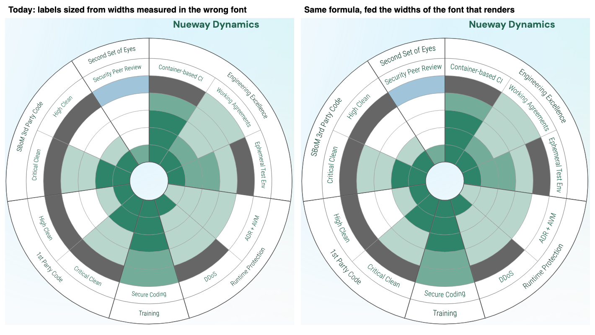

# Blueprint's Radar, kept for the port

This is the practice-adoption radar chart from Blueprint, copied from `~/Projects/blueprint-ng` ([transformation-dev/blueprint-ng](https://github.com/transformation-dev/blueprint-ng), commit `e98a798`). It gets ported into the Blueprint replacement that will be built on Lumenize after pre-alpha, which `tasks/backlog.md` § *Other Nebula backlog* tracks.

| File | What it is |
|---|---|
| `Radar.svelte` | The ring, and the code that sizes every label |
| `Sidebar.svelte` | The legend and summary stats beside the ring |
| `Slice.svelte`, `Arc.svelte` | One practice's wedge, and one arc with its label drawn along it |
| `arc-translators.js`, `color-utils.js`, `types.ts` | Helpers |
| `LandingRadar.svelte` | The landing page's data, which every measurement here ran on |
| `measure-labels.mjs` | Measures how a running page sizes the labels |
| `measurements-2026-10-09.txt` | That script's output against a dev server and a production build |

## The label sizing is wrong

Each label is rendered off-screen, measured with `getBBox` in `onMount`, and its font is scaled to fit its slot. The scaling is right and the measurements are not:

1. **The ring measures in the wrong font.** Its measuring text gets the page's DM Sans, while `Arc.svelte` renders the labels in Roboto Condensed. Svelte scopes each component's styles, so Arc's font rule never reaches the measuring elements in `Radar.svelte`.
2. **The ring and the legend both measure before the font has loaded**, so they get a fallback face's widths.
3. **On a first visit to a production build, they measure before any CSS applies**, so everything measures in Times.

All three make labels smaller than their slots, and the first-visit cases make them change size on a repeat visit. The comment above `Radar.svelte`'s `onMount` has the numbers and the fix. On the left below is what renders today; on the right is the same page with each label at the size the formula gives from the widths of the font that renders.



## Checking a port

Serve the ported radar with `LandingRadar.svelte`'s data, then run:

```sh
node tasks/reference/blueprint/ui/Radar/measure-labels.mjs <url> <output-dir>
```

It loads the page with an empty cache and again with a warm one. The port is fixed when two of its report lines hold:

- **`ring sizes, actually rendered` and `legend font sizes rendered`** match between the cold and warm runs.
- **`widest practice label ... fills`** reads about 95% of its slot, the margin the formula leaves.

Run it against a production build as well, because the case where CSS has not applied yet only shows there. The per-label rows come from wrapping `getBBox`, so they stay empty if the port measures another way, and the two lines above do not depend on them. The slot geometry is written for `LandingRadar.svelte`'s props inside `analyze()`, so a port tested on other data needs those constants changed.
